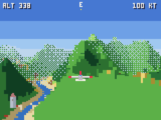
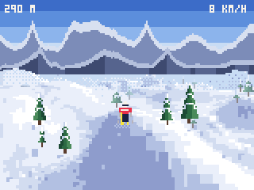
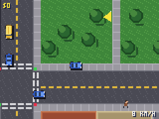
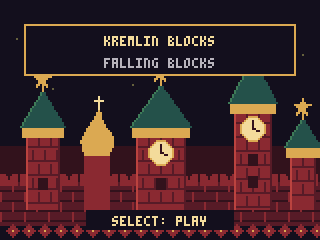

# PodBox games

Games for the Arcade of [PodBox](https://github.com/anthonyfletcher/podbox), the firmware for the iPod Video and iPod Classic.

   

| Game | What it is | Docs |
|---|---|---|
| [Pulse Tunnel](pulsetunnel/) | A tube shooter that flies to your own music | [docs/pulsetunnel.md](docs/pulsetunnel.md) |
| [Marble Chain](marbles/) | A marble shooter with six levels and power-ups: stop the chain before it reaches the hole | [docs/marbles.md](docs/marbles.md) |
| [Bubble Beat](bubblebeat/) | A bubble shooter whose ceiling comes down with the bars of your music: shoot on the beat for double | [docs/bubblebeat.md](docs/bubblebeat.md) |
| [Pocket Wings 3D](pocketwings/) | A relaxed flight over six 3D landscapes, no score, no hurry; Discovery finds thirty landmarks; plays in a browser too | [docs/pocketwings.md](docs/pocketwings.md) |
| [Sloop](sloop/) | A wrecking ball on the beat: swing it with the wheel to smash the blocks landing on the beats of your music | [docs/sloop.md](docs/sloop.md) |
| [Outpost Echo 3D](outpostecho/) | A first-person sci-fi adventure: restore five sectors of a silent research station, past its security robots | [outpostecho/README.md](outpostecho/README.md) |
| [Pocket Golf Deluxe](pocketgolf/) | Top-down mini golf: 36 holes in four themed courses, with tunnels, teleporters, gates and ice | [pocketgolf/README.md](pocketgolf/README.md) |
| [Powder Run 3D](powderrun/) | Endless downhill skiing over a 3D mountain: five slopes, pines and boulders, Free Ride and Endless Run, plays in a browser too | [docs/powderrun.md](docs/powderrun.md) |
| [Pocket City 3D](pocketcity/) | An open city seen from above: five districts, traffic and lights, people, any car you can get to, twenty jobs, the police and thirty lost tapes; plays in a browser too | [docs/pocketcity.md](docs/pocketcity.md) |
| [Beat Dancer 3D](beatdancer/) | A 3D robot dances on a disco floor, the lights keeping time with your music | [beatdancer/README.md](beatdancer/README.md) |
| [Kremlin Blocks](kremlinblocks/) | Falling blocks in a city of onion domes: Marathon, Sprint and Blitz, five stages from Red Square by day to the night sky | [kremlinblocks/README.md](kremlinblocks/README.md) |

Every game has been played on an iPod Video 5.5G.

## Playing

Download a game's `.pbg` from the [latest release](https://github.com/cyberdeliaAI/podbox-games/releases/latest), copy it to a folder called `Games` on the iPod, eject it, and pick **Arcade** on the main menu.

Marble Chain, Pocket Wings 3D, Powder Run 3D, Pocket City 3D, Outpost Echo 3D, Pocket Golf Deluxe and Kremlin Blocks play in a browser too: [cyberdeliaai.github.io/podbox-games](https://cyberdeliaai.github.io/podbox-games/). The games that follow your music can't.

Every push also builds each game into a `.pbg` (the **Actions** tab: open a run and download the game from its artifacts). A tag, such as `v1.0`, attaches them all to a release and publishes the browser pages.

To play or edit in a browser, open a game's folder (or its `.pbg`) in the [Arcade IDE](https://anthonyfletcher.github.io/podbox/ide/). Chrome and Edge edit the folder in place.

## Building

Every folder with a `cart.json` is a cart. With the PodBox repository cloned next to this one:

```sh
(cd ../podbox/arcade/sdk && npm ci --omit=dev)   # once
sh build.sh                                     # every cart into dist/ (not kept in git)
```

`tools/` holds the scripts that make each game's placeholder art and data, and the stress tests:

```sh
python3 tools/marbles_stress.py      # plays every level by itself, checks the chain, reports units a tick
python3 tools/bubblebeat_stress.py   # the same for Bubble Beat, with and without music
python3 tools/sloop_stress.py        # the same for Sloop: a smart, a blind and a still player
python3 tools/pocketwings_test.py    # flies Pocket Wings, checks it and measures every level (--sessions: long flights, saves, memory)
python3 tools/powderrun_test.py      # the same for Powder Run, skiing (--sessions: long runs, saves, memory)
python3 tools/pocketcity_test.py     # plays Pocket City on wheels and on foot, with the police and all the jobs, checks it and measures it
python3 tools/outpostecho_test.py    # plays Outpost Echo's whole campaign, checks saves and measures it
python3 tools/pocketgolf_test.py     # plays all 36 holes of Pocket Golf, checks the physics and measures it
python3 tools/beatdancer_test.py     # Beat Dancer silent, with and without a beat, across playlists and pauses, every style, against the budget
python3 tools/kremlinblocks_test.py  # Kremlin Blocks' rules, an autoplay replayed through real input, saves, pauses, the budget
```

To add a game, give its folder a `cart.json` and add its name to the cart list in `.github/workflows/build.yml`.

`python3 tools/screenshots.py` takes the pictures in `docs/screenshots/`, and `docs/posts/` has a forum post for each game.

## Licence

MIT: see [LICENSE](LICENSE). The code, the art (made by the scripts in `tools/`), the levels and the sound effects are all original.
