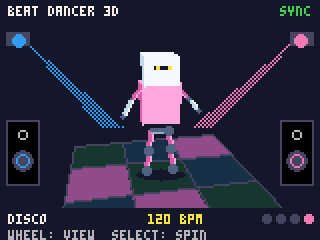

# Beat Dancer 3D

A small disco demo for PodBox Arcade. An original articulated robot dances
while nine floor tiles, moving coloured spotlights and speaker lights
follow the same musical phase. It reads the owner's music and never
changes playback, volume or the queue. It doesn't play sound effects.



This silent preview is captured from the native cartridge at a simulated
120 BPM. The real cartridge listens to the music playing on the iPod.

## Controls

| Control | Action |
| --- | --- |
| Wheel | Turn the view around the dancer |
| Prev / Next | Choose Groove, Robot or Disco |
| Select | A four-beat spin with raised arms |
| Play | Toggle camera orbit |
| Menu | Native pause and demo options |

Auto choreography changes style every 32 beats. Options select music sync,
a silent demo tempo from 60 to 180 BPM, style, orbit and a units overlay.
The menu can reset the camera or ask for another attempt at finding the
music's beat. Holding a control doesn't repeat the toggle.

## Following music

`SYNC` means the motion and light phase come from `beat.clock()` and the
tracker's predicted next beat. `LISTEN` means it's finding a tempo. The
robot and floor use a light neon rendering during that short window.
Once it holds a tempo with enough confidence, the analyser stops and the
filled robot and disco floor appear. Spectrum energy also changes the
size of the robot's weight shifts.

A try lasts at most ten seconds. There's one retry after twenty seconds.
If the track has no clear beat, `DEMO` shows that the silent internal tempo
is in use. New tracks, seeks and returning from pause ask for a new lock.
The tempo is estimated, so some music may be followed at half or double
its expected BPM. It can also fail to find a beat. The fallback isn't
presented as music sync.

## Build and test

Use the SDK at `../podbox/arcade/sdk`, with its Node dependencies installed
and native VM built using `sh host/build.sh`. Build this cart on its own
so concurrent work on other games isn't involved:

```sh
mkdir -p dist
node ../podbox/arcade/sdk/pbgc.js build beatdancer -o dist/beatdancer.pbg
python3 tools/beatdancer_test.py --keep dist/beatdancer-checks
```

The test and preview scripts accept `--sdk` or the `SDK` environment
variable. They only build this cart. Instrumented copies live in temporary
folders. The uninstrumented cartridge supplies performance measurements.

Regenerate the original art and native preview:

```sh
python3 -m pip install 'Pillow==12.3.0'
python3 tools/beatdancer_assets.py
python3 tools/beatdancer_preview.py
```

The art generator owns the palette, floor atlas, blank sheet and logo.
The atlas holds 32 projected camera angles of the floor. It has no frames
of the dancer. The joints, head, chest and choreography animate live.

For a direct native run:

```sh
../podbox/arcade/sdk/host/pbgvm dist/beatdancer.pbg --ticks 2000 --playing --beat 120 --seed 1 --units --shot /tmp/beatdancer.png
```

Drop `--playing --beat 120` to measure the silent demo. Use `--beat 0` for
the fake library's playlist changes. `--units` includes the SDK's analyser
charge. The independent `.github/workflows/beatdancer.yml` pins SDK commit
`126ebba20eb4f650d98ec03e6838d226af2e7013`, builds the cart and tests it. It
uploads a workflow artifact without publishing anything. The repository's
`build.sh` also discovers the cart. Shared build and Pages workflows were
left alone while another developer works on the other games.

The normal browser exporter refuses carts that read the owner's music.
This demo is supplied as a native `.pbg`, with a GIF for review. No browser
music support is claimed.

## Performance and checks

The cart runs at 25 Hz. The iPod Video with FLAC budget is 17,500 units per
tick. The native checks cover silent mode, no detected beat, 48 and 180
BPM, playlist changes, pause, VM suspension, minimum and maximum demo
tempo, held controls, all styles, spins, camera views and the overlay.
They require every measured plain-cart tick to fit that budget.

The probe checks phase, tempo, bounded listening, stopped analysis after
lock, camera and spin ranges, primitive capacity, projected depth and
painter order. It compares the animation phase directly with the music
clock after lock. Fault injection proves it catches an invalid lighting
envelope. The long playlist case lasts 45,000 ticks, or thirty minutes at
25 Hz. Reports are saved under `dist/beatdancer-checks`.

Hardware playback latency, audible beat alignment and real click-wheel
feel still need review on an iPod Video and Classic with actual music.
VM unit checks don't measure all screen transfer or garbage collection
time. This is a working demo, version 0.1, rather than a hardware-validated
release.

## Files and editing

| File | Purpose |
| --- | --- |
| `cart.json` | Unique ID, read-only music access, 25 Hz and options |
| `main.js` | Controls, styles, camera and four-beat spin |
| `music.js` | Listening windows, confidence, fallback and music phase |
| `dancer.js` | Procedural choreography and 3D rig positions |
| `mesh.js` | Perspective projection, solid head/chest, limb strips and depth ordering |
| `stage.js` | Projected floor atlas, beat colours, lights and speakers |
| `hud.js` | Honest sync state, BPM, style and optional units |
| `tools/beatdancer_assets.py` | Original generated floor, palette, sheet and logo |
| `tools/beatdancer_test.py` | Native sync, controls and performance checks |
| `tools/beatdancer_probe.js` | Scratch-only invariant checks |
| `tools/beatdancer_preview.py` | GIF capture from the real cartridge |

The renderer is a small hybrid. The head and chest are solid 3D boxes.
The limbs use shaded camera-facing strips between real 3D joints, a cheap
cylinder approximation. Body parts are sorted from far to near. The view
uses 32 camera steps so the baked floor shares the dancer's perspective.
A solo spin rotates the live model continuously while the floor stays put.

Keep typed arrays fixed and allocated at top level. Every extra `.js` file
is a namespace. Use `var` inside functions and avoid API names for globals.
Use integer screen areas when culling. Divide before multiplying large
fixed-point values, especially milliseconds. Don't add `rspr`, per-pixel
loops or continuous music analysis. Measure both listening and locked
states after renderer changes. Code and docs are English, with no em
dashes or Oxford commas.
