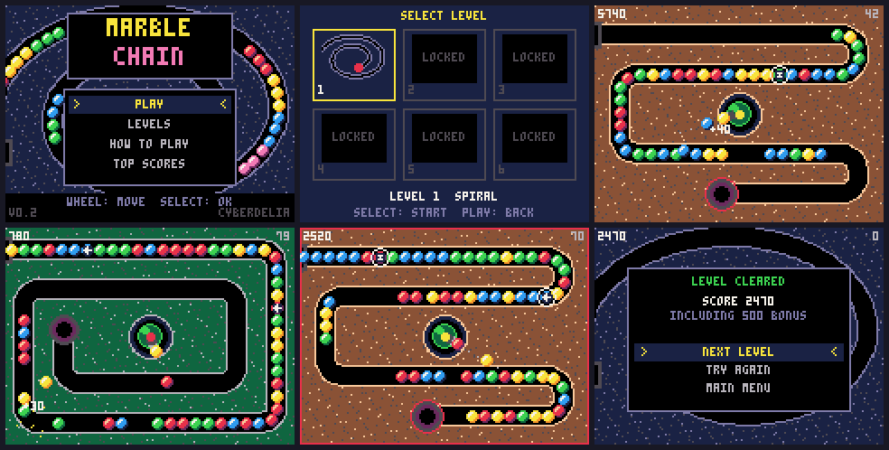

# Marble Chain

A marble shooter for the PodBox Arcade. A chain of coloured balls rolls along a track toward the hole. You shoot balls into it from the gun in the middle: three or more of one colour together pop. Where a gap's two sides are the same colour, the chain rolls back to close it, and that can pop again.

Version 0.2 adds the start screen, six levels on three tracks, power-ups, a better score, a warning near the hole and saved progress. The chain engine underneath is the one from 0.1, with power-up balls added.

## Controls

- **Aim**: rest your thumb on the wheel and the gun points there. Switch to Spin in the pause menu to aim by turning the wheel instead (finer, and Prev and Next turn the gun too).
- **Shoot**: tap Select. The shot leaves when you let go.
- **Swap** the loaded ball and the next one: hold Select for a moment, or press Play.
- **Menus**: turn the wheel (or press Prev and Next) to move, Select to choose, Play to go back. The pause menu has Restart level and Main menu.

The aim holds still while Select is down, so moving your thumb from the ring to the centre button doesn't pull it off target.

## The start screen

A chain rolls round a spiral behind the menu. The menu has four rows:

- **Play** carries on at the furthest level you have opened. It reads *Continue level 3* once you have got that far.
- **Levels** shows the six levels with a picture of each track, the best score on it, and a lock on the ones not opened yet.
- **How to play** is a one-page explanation, with the three power-ups.
- **Top scores** opens the Arcade's own score table.

After a level, the end panel offers *Next level* (when you cleared it), *Try again* and *Main menu*.

## Levels

| # | Name | Track | Balls | Colours | Speed | Power-ups |
|---|---|---|---|---|---|---|
| 1 | Spiral | spiral | 45 | 3 | 0.16 | none |
| 2 | Zigzag | serpentine | 55 | 4 | 0.18 | 1 in 22 balls |
| 3 | Square | square spiral | 65 | 4 | 0.20 | 1 in 20 |
| 4 | Whirl | spiral | 80 | 5 | 0.22 | 1 in 18 |
| 5 | Switchback | serpentine | 90 | 5 | 0.24 | 1 in 16 |
| 6 | Labyrinth | square spiral | 100 | 6 | 0.27 | 1 in 14 |

Speed is pixels a tick at 33 ticks a second. Clearing a level opens the next. All of this is in `levels.js`, in plain lists, so a level is one more entry in each.

## Scoring

- Every popped ball is worth 10, times the chain reaction's depth (a pop that sets off another pop counts double, then triple, and so on).
- A run of four or more adds 20 a ball over the third.
- A **streak** is shots in a row that popped something. From the second one a shot earns 10 more per step, up to 100. A shot that pops nothing resets it.
- Clearing a level adds 500.
- The best score on each level is kept. Every finished run goes to the Arcade's score table too.

## Chain speed

The chain eases to 60% of its speed for a moment after every pop, so a good shot gives you room. Whenever the front of the chain is short (at the start, or after a big clear) it rushes in, many times its normal speed, until it has filled the first third of the track. Near the hole the screen warns you: the hole pulses, the border flashes red and a beep gets faster the closer the chain comes.

## Power-ups

Some balls carry a mark and flash a white ring. They are balls of a normal colour that go off when the run they are in pops.

| Mark | What it does |
|---|---|
| Hourglass (slow) | The chain crawls at 30% speed for about seven seconds |
| Arrow (back) | The chain rolls back toward the tunnel for over a second; balls that go right back in come out again later |
| Burst (bomb) | Pops every ball within about two and a half balls of the run, along the chain |

## How the chain works

The track is a list of points, one for every pixel of its length, so a ball is just a colour and a distance along it. The balls are kept in one sorted list, from the back of the chain (nearest the tunnel) to the front (nearest the hole). Four rules run every tick, in this order:

1. **Push.** The tunnel pushes the rearmost ball forward at the chain's speed and lets out a new ball behind it whenever there's room.
2. **Make room.** A ball closer than one ball's width to the one behind it is pushed forward, at most a set distance a tick. A push carries on through every ball it touches, so the whole run in front of the pusher moves as one. A ball with a gap behind it isn't pushed, so a run cut off from the back stands still.
3. **Pull back.** Where the two balls either side of a gap are the same colour, the run in front of the gap rolls back toward the other until they touch.
4. **Join.** A gap that closes is a join. Where the colours meet, the run of that colour is counted, and three or more pop: a chain reaction, worth more each time it happens again from the same shot.

A ball shot into the chain is inserted into the sorted list at once, on the side of the ball it hit. It rolls from where it hit into its place over a few ticks while rule 2 opens the space for it, and only then is its colour matched. A matched run pops over a few ticks, still holding its place, and is then taken out, leaving a gap for rule 3 to close.

Every ball's state (rolling, arriving, popping) lives in the same arrays as its colour and position and moves with it when the arrays shift. Nothing refers to a ball by its index for longer than one tick, so inserting and removing balls can't leave stale references behind.

A power-up is one more number kept for every ball (`pw`), shifted with the other arrays. When a run pops, `match()` collects the power-ups in it: slow and back are reported to the game (`gotPower`), a bomb is carried out by the chain itself (`blast`, which marks every ball within reach as popping with the run). `rewind()` moves every ball back along the track and returns the ones that go right back in to the tunnel.

Shots find their ball with `hitTest()`. Most of a shot's flight is over empty ground, so each track carries a small map (20 by 15 squares, made by the asset script) of where a ball could be within reach; outside it the shot skips the search.

## Stress test

`python3 tools/marbles_stress.py` plays every level by itself and checks the chain's invariants at the start of every tick: the list stays sorted, the colour counts match the balls, no ball is stuck in a state or left without a timer to finish it, no popping ball still carries a power-up, every gap is flagged and no ball sits further back in the tunnel than it should. It reports the units each tick of play costs, with its own work taken out.

It plays three ways. Smart aims where the loaded ball pops a run, nearest the hole, and swaps when the next ball does better. Blind shoots at random. Still never shoots, so the whole chain rolls to the hole. By default it runs six levels, two seeds, smart and blind, 9,000 ticks each, in about a second. `--selftest` raises `POP` from 8 to 12 in a scratch copy to show the checks catch a pop that outlasts its timer.

The game's own files are never changed: the tool builds a scratch copy of the cart with `tools/marbles_stress.js` added and a call to it at the top of `update()`.

On 14 November 2026 it found no violations. It did warn 23 times that `rewind()` was about to send a popping ball back into the tunnel. That ball has already been scored, and it comes out again later as a new ball.

## Saved progress

The game keeps seven of the Arcade's saved numbers: number 0 is how many levels are open, numbers 1 to 6 are the best score on each level (capped at 30,000, which is as far as the Arcade's numbers go).

## Performance

Measured with the stress test, its own work taken out:

| Run | Average | 95th percentile |
|---|---|---|
| Start screen | 3,850 | 5,500 |
| Level 1, smart shot every 0.6 s | 4,750 | 7,050 |
| Level 3, same | 5,500 | 8,500 |
| Level 6, same | 6,200 | 8,800 |
| Level 6, no shots: the whole chain rolls to the hole | 11,200 | 16,400 |
| Level 6, random shot every 0.6 s | 11,900 | 18,200 |

Units a tick. An iPod Video playing FLAC gives a cart about 12,500 at 33 ticks a second. A player who keeps the chain short stays inside it on every level: the worst smart tick in 12 runs was 11,850. A long chain doesn't. Each ball on screen costs about 135 units a tick, and each shot in flight checks every ball. Left to grow, the chain on levels 4 to 6 is over 12,500 on 9% to 36% of ticks, and random shooting on level 6 puts 8% of ticks over 17,500. If frames run late for a whole second the game drops to 25 ticks a second by itself, and every speed in it is scaled to match, but that doesn't cover the worst of level 6.

The start screen draws its menu once into a picture, rolls only the balls that are not behind it, and moves them every other tick.

## Files

| File | What it does |
|---|---|
| `main.js` | The game around the chain: scenes, levels, scoring, power-ups, the HUD and the end panels |
| `title.js` | The start screen, the level picker and the instructions |
| `levels.js` | The six levels, the tracks and saved progress |
| `chain.js` | The chain: the four rules, power-ups, inserting shots, matching and drawing the balls |
| `gun.js` | Aiming, loading, firing, swapping and the balls in flight |
| `data/path1.json` to `path3.json` | The tracks, one point a pixel, with their reach maps |
| `images/bg1.png` to `bg3.png`, `sheet.png`, `logo.png` | The art |
| `sounds/` | Shoot, clack, pop, swap, power, slow, blast, warn, tick, start, win and lose |

`tools/marbles_assets.py` makes the tracks, the backgrounds, the sprite sheet (balls, power-up marks and the gun turned to 32 directions) and the logo. Change a track in `spiral()`, `zigzag()` or `square()` and run it again.

## The plan

1. **Prototype** (done in 0.1): one track, the gun, moving balls and collisions, with the full chain engine.
2. **Game rules** (done in 0.2): streaks and chain scores, a proper win and loss, the chain easing and rushing, danger near the hole.
3. **Presentation** (0.2, first pass): start screen, menus, level picker, end panels, new gun and backgrounds, sound effects. The art is still made by script and could be redrawn by hand.
4. **Full game** (0.2, first pass): six levels on three tracks, rising difficulty, three power-ups, saved progress. More tracks and levels, and a coin or fruit bonus on the track, would come next.
