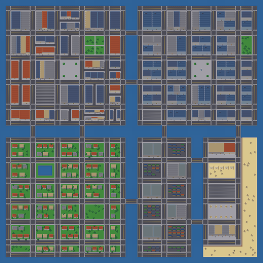

# Pocket City 3D


An open-world city game seen from above, for the PodBox Arcade: drive and walk about a city of five districts, take whatever car you like, do the work the phone boxes offer, find the tapes lost about the city and keep ahead of the police. An original game in the top-down open-city genre, with its own city, art and rules.

## The city



256 by 256 cells of 8 pixels, five districts on islands joined by nine bridges:

| District | What it is like |
|---|---|
| Old Town | A grid of streets with alleys, a park, a plaza and a car park. Where you start |
| Downtown | Towers of glass and stone, Civic Square with its fountain, a car park and a small park |
| Greenside | Houses in gardens, the lake, two parks |
| The Harbour | Warehouses and yards of containers |
| Sunset Beach | Hotels, beach huts, the promenade, a car park, the beach with its palms and boardwalk |

The traffic drives on the right. Every junction of four streets has lights.

## Controls

At the wheel:

| Control | Action |
|---|---|
| Select (held) | Throttle |
| Prev (held) | Brake, then reverse |
| Wheel | Steer. Let go and the wheels come back straight |
| Play (held) | Handbrake: the back steps out, for a slide round a corner |
| Next | Get out, when the car all but stands still; the horn when it doesn't |

On foot:

| Control | Action |
|---|---|
| Wheel | Turn |
| Select (held) | Walk; with Play held as well, run |
| Next | Into the nearest car within reach |

With Thumb steering (pause menu) the front wheels follow where your thumb rests on the wheel, right or left of the top, and on foot you face where your thumb rests. Menu (held) pauses; the pause menu has the city map, the main menu and the options.

## Playing

- **Cars.** Any car standing or crawling can be yours: walk up to it and press Next. A parked one is free for the taking; one with a driver in it, they jump out and run, and that's theft. Your last car stays where you left it. The cars drive differently: the van is slow off the mark and tops out low, the sports car is quick at both.
- **People** walk the sidewalks, the plazas and the parks. A car coming at them fast makes them jump aside. One you hit anyway falls over, gets up a couple of seconds later and runs off.
- **The police.** Running a red light, ramming a car, knocking someone down, taking a car with its driver in it and ramming the police all add heat. Seen by a police car, the whole of it counts; unseen, half, and never past one star. 20 heat is one star, 50 two, 80 three, and each star puts a police car on the streets. They come with sirens, through red lights, and leave the street to chase you when near. Stand still with one beside you (or be on foot) for a second and a half and you're busted: a $200 fine, any job lost, and you start again in Old Town. Out of their sight for five seconds the heat starts to fall. A paint shop in every district (the green rings on the map) gives a wanted car fresh paint for $100, and the police forget it.
- **Jobs.** Twenty, four a district, in turn: Old Town's first, then Downtown's, Greenside's, the Harbour's and Sunset Beach's. The next job waits at its district's phone box, where the yellow arrow points; get there with no police after you and it starts. Each has a time limit and pays when done.

| Job | What to do |
|---|---|
| Delivery | Pick up the parcel, take it to an address in another district |
| Taxi | Stop by the fare: they get in. Stop at their address. Get out on the way and they walk |
| Time trial | Drive through seven junctions in turn |
| Chase | A getaway car flees: ram it four times before it gets away |

- **Tapes.** Thirty tapes are lost about the city, six a district, out of the way: alleys, parks, yards, gardens, the beach. Find all thirty and the car at the start is gold from then on.
- **Saved**: your money, the jobs done, the tapes found and the districts you've seen. You always start in Old Town.

## How it works

- **The city is painted, then cut into tiles.** `tools/pocketcity_assets.py` plans the city as cells (streets, sidewalks, plots, parks, water, sand, containers, railings), paints it as one picture with a fixed, gentle 2.5D look (every roof on its plot with its south wall below it, shadows to the east, the sun in the north-west), cuts the picture into 8x8 tiles and keeps each different one once: 233 of the sheet's 255. Anything that varies from cell to cell costs tiles, so the grass, the sand, the water and the roofs repeat exactly in every cell; only the asphalt has two kinds. Each tile gets its flags from what its cell is: `solid`, `water`, `grass` (grass and sand slow a car), `walk`, `road`.
- **The scroll ring.** Drawing a screenful of cells with `map()` every tick costs about 12,500 units: the whole of a tick on an iPod Video playing music. So `city.js` draws the cells once into a picture of 22 by 17 cells and keeps cell (c, r) at (c mod 22, r mod 17); as the camera moves only the column or row coming into view is drawn into it, and the screen is copied out of it opaque in up to four parts where it wraps. About 1,300 units a tick, plus some 550 for each column or row drawn. A jump of the camera (being busted) draws the whole ring, about 13,000 units, once.
- **The streets** are a network the assets script finds in the city it painted: 147 junctions, each with its neighbours north, east, south and west and whether it has lights (74 do), in `data/roads.json`. The map is cut into squares of 32 cells that list their junctions, so finding the ones near a place looks at a few.
- **Traffic** (`traffic.js`) keeps about nine cars round the player: a car comes into being on a street out of sight, 110 to 200 pixels off and mostly heading your way, and goes when further than 250 and out of sight. A car is a distance along a street from the junction behind it. A little before the junction ahead it chooses where to go on, and a turn is a quarter circle across the junction: 8 pixels round to the right, 24 to the left. It slows for the turns, stops at a red light and keeps its distance from whatever is ahead in its lane. A knock shoves it: an offset from its lane that eases back to nothing, so it never has to find its lane again. Out of sight, a car moves every other tick, twice as far.
- **Knots.** Two cars each holding the other up across a junction, or a car behind a parked one, squeeze past after three seconds. A queue just waits.
- **People** (`people.js`) are kept round the player the same way, about nine, walking the sidewalks one way at a time and turning where they end. Out of sight they move every third tick.
- **The police** (`police.js`) drive the lanes toward where they last saw you, choosing at each junction the way that gets nearer. Near and with a clear view (three points between them and you, none a building), one leaves the lanes and heads straight at you, sliding along walls; losing you, it is put back on the nearest lane and its offset eases it there.
- **The cars' pictures** are 32 headings of each of four shapes in `images/cars.png` (sedan, van, sports, police), 16x16 a frame, used as a sheet with `sheet()`: `rspr` would cost about 780 units a car, a ready-turned frame about 200. Paints are a `pal()` swap of the body's three colours; the police lights flash the same way.
- **People's pictures** are in the same slant as the buildings, 8x8, facing four ways, three frames each, their shirts and trousers swapped with `pal()`.
- **Messages** are fixed texts and a number with a form (money, a district's name, a count), put together only as they are printed, so nothing made in play is kept.
- **The city map** (`images/citymap.png`) is the city at a pixel for two cells, made by the assets script.

## Performance

`python3 tools/pocketcity_test.py`, units a tick of play, on `pbgvm`:

| Runs | Avg | p95 | Max | Over 12,500 |
|---|---|---|---|---|
| Spin and Thumb, 8 runs of 9,000 ticks, about half on foot | 8,200 to 9,000 | 10,000 to 10,700 | 13,100 | 0% to 0.1% |
| The police after you, 4 runs | 7,600 to 8,000 | 9,900 to 10,900 | 24,500 (busted: the ring drawn afresh) | 0.1% to 0.7% |

A tick of driving is about 1,300 for the city, 1,600 for the traffic, 1,000 for the people, 600 for the cars' pictures, 500 for the traffic lights, 450 for the numbers and the rest for the player, the police and the jobs. More than four late frames in a second drop the game to 25 ticks a second (17,500 units) for good, as the other carts do; speeds go by `33.0 / rate()`, so it plays the same. The ticks after the camera jumps don't count.

## Testing

```sh
python3 tools/pocketcity_test.py                  # seeds 1 to 4: Spin, Thumb, the police after you; and the jobs
python3 tools/pocketcity_test.py --seeds 1,2,3,4,5,6 --ticks 30000
python3 tools/pocketcity_test.py --selftest       # four breaks: the checks must catch each
```

The tool plays from a plan made from the seed, played in through pbgvm's wheel and buttons: the throttle held most of the time, turns, braking, reversing, handbrake slides, and now and then a stop to get out, walk or run about and get into the nearest car (on foot too long, the harness parks one beside the player). The police runs put three stars of heat on every 400 ticks the player has none, carry $1,000 and drive into a paint shop now and then. The jobs run plays all twenty jobs, putting the car where each wants it (the harness's pilot; for a chase, just behind the getaway car and faster), lets some taxi fares run out of time and then picks up all thirty tapes; it must finish all twenty.

Every tick it checks: the player in a car or on foot never in a wall; the car's speed, heading and steering; the camera inside the map and the ring holding its cells; every car on its lane (a road under it, its junctions and its place along the street agreeing) or, parked or chasing, off the walls; every person off the walls; the heat and the stars agreeing; the jobs' state, and a job done always paid; and seven pixels of the last frame, away from anything drawn over the city, matching the map's tile pixels there. It reports overlaps (two cars on top of each other in a lane) as a count, not a failure: the police put back on a busy lane can land on another car for a moment.

The self-tests: the car through walls, the ring forgetting a column, the traffic on the sidewalk, a job that pays nothing.

## Files

| File | What it does |
|---|---|
| `main.js` | The scenes, the order of a tick, the offences, the sounds, saving, being busted |
| `city.js` | The scroll ring and what is where (`at()`: a cell's flags) |
| `roads.js` | The street network and its lights |
| `car.js` | The player's car: throttle, brakes, steering, grip and the handbrake, walls and crashes, the four shapes |
| `player.js` | At the wheel or on foot: walking, getting in and out |
| `traffic.js` | Every other car: lanes, turns, lights, knocks, parked cars, coming and going, drawing |
| `people.js` | The people on the sidewalks |
| `police.js` | The heat and the stars, the police cars, red lights, being busted |
| `jobs.js` | The jobs, the tapes, the paint shops and the districts |
| `view.js` | The camera looking ahead, the picture, the traffic lights |
| `hud.js` | The money, the stars, the speed, the job's clock and aim, the messages, the arrow, the city map |
| `title.js` | The start screen over the city gliding past, and how to play |
| `sheet.png`, `flags.json`, `maps/city.json`, `data/roads.json`, `data/city.json`, `images/*.png`, `palettes/city.gpl`, `logo.png` | Made by `tools/pocketcity_assets.py` |
| `sounds/` | Tick, start, crash, bump, horn, door, tape, job, pass, fail, busted, check, spray |

## How it was built

In four phases: the driving prototype (Old Town, the car, the scroll ring, the camera); a living city (traffic in its lanes, the lights, people, knocks, four kinds of car); open-world play (on foot, changing cars, the jobs, the wanted level and the police); and the whole city (five districts on one map with bridges, saved progress, the tapes, the sounds, the city map). One map for the whole city rather than a load per district: loading would stall on an iPod whose disk is resting.
