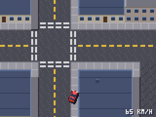
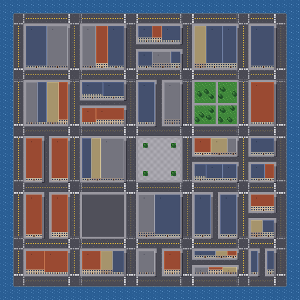

# Pocket City 3D



An open-world city game seen from above, for the PodBox Arcade: drive about a small city, and later get out, find secrets, take on missions and keep ahead of the police. An original game in the top-down open-city genre, with its own city, art and rules.

This is phase 1 of the plan below: one district (Old Town), one car, how it drives and slides, walls to hit and a camera that looks ahead. No traffic, people or missions yet.

## Driving

| Control | Action |
|---|---|
| Select (held) | Throttle |
| Prev (held) | Brake, then reverse |
| Wheel | Steer. Let go and the wheels come back straight |
| Play (held) | Handbrake: the back steps out, for a slide round a corner |
| Next | The horn (getting out, from phase 3) |
| Menu | Pause: Restart drive, Main menu, options |

With Thumb steering (pause menu) the front wheels follow where your thumb rests on the wheel, right or left of the top.

- The car tops out at about 130 km/h (by the game's scale) and takes a couple of seconds to get there. Off the throttle the engine slows it.
- Grass slows it a lot, sidewalks a little.
- The tyres take most of the sideways speed each tick, so the car goes where it points; the handbrake lets go of that and the car slides.
- Water, buildings and trees are walls. The car slides along them and bounces back a little; a hard knock is a crash.
- The camera looks ahead the way the car is going, so there is more of the road in front of it at speed.

## Old Town



128 by 128 cells of 8 pixels, a kilometre or so across by the game's scale: streets of two lanes in a grid, alleys through some blocks, a park, a plaza, a parking lot, water all round. The other four districts come in phase 4.

## How it works

- **The look** is a fixed, gentle 2.5D, as the concept asked: every building's roof is drawn on its plot with its south wall below it (windows and a door), and its shadow falls on the ground to the east, the sun being in the north-west. Trees cast round shadows. All of it is in the tiles, so it costs nothing at run time, and the city stays a flat grid of cells for driving and collisions.
- **The tiles come from a picture.** `tools/pocketcity_assets.py` paints the whole district as one picture from a plan of cells (roads with centre lines and crossings at the junctions, sidewalks with kerbs, roofs, walls, shadows, grass, trees, water with its quay), then cuts it into 8x8 tiles and keeps each different one once: 144 of the sheet's 256. Each tile gets its flags from what its cell is: `solid` (buildings, trees, water), `water`, `grass`, `walk`, `road`.
- **The scroll ring.** Drawing a screenful of cells with `map()` every tick costs about 12,500 units: the whole of a tick on an iPod Video playing music. So `city.js` draws the cells once into a picture of 22 by 17 cells and keeps cell (c, r) at (c mod 22, r mod 17); as the camera moves only the column or row coming into view is drawn into it, and the screen is copied out of it opaque in up to four parts where it wraps. About 1,300 units a tick, and some 550 for each column or row drawn.
- **The car** comes from its own picture (`images/cars.png`, used as a sheet with `sheet()`), drawn at 32 headings by the assets script: `rspr` would cost about 780 units a car a frame, where a ready-turned frame costs about 200. Its shadow is in the frame.

## Performance

`python3 tools/pocketcity_test.py`, eight runs of 9,000 ticks (Spin and Thumb steering, four driving plans), units a tick:

| Avg | p95 | Max | Over 12,500 |
|---|---|---|---|
| 2,600 to 3,000 | 2,900 to 3,600 | 4,600 | 0% |

That leaves about two thirds of the tick at 33 a second on an iPod Video playing FLAC for the traffic, people and police of the phases to come. The measurements behind the plan: a 2x2 sprite about 170 units, an 8x8 one about 70, `actors.move` for 24 cars against the map about 520.

## Testing

```sh
python3 tools/pocketcity_test.py                  # seeds 1 to 4, Spin and Thumb, 9,000 ticks each
python3 tools/pocketcity_test.py --seeds 1,2,3,4,5,6 --ticks 30000
python3 tools/pocketcity_test.py --selftest       # the car through walls, and the ring forgetting a column: both must fail
```

The tool drives from a plan made from the seed, played in through pbgvm's wheel and buttons: the throttle held most of the time, turns, braking, reversing and handbrake slides. Every tick it checks that the car is on the map and never in a wall (looked at on its own, not through the car's code), its speed, heading and steering, the camera inside the map, the ring holding the camera's cells, and seven pixels of the last frame, away from the car and the numbers, against the map's tile pixels at that place in the world.

## Files

| File | What it does |
|---|---|
| `main.js` | The scenes, the options, the engine's and tyres' sounds, the order of things |
| `city.js` | The scroll ring and what is where (`at()`: a cell's flags) |
| `car.js` | The car: throttle, brakes, steering, grip and the handbrake, walls and crashes |
| `view.js` | The camera looking ahead, the city and the car |
| `hud.js` | The speed, the district's name, the frame rate |
| `title.js` | The start screen over the district gliding past, and how to drive |
| `sheet.png`, `flags.json`, `maps/oldtown.json`, `images/cars.png`, `palettes/city.gpl`, `logo.png` | Made by `tools/pocketcity_assets.py` |
| `sounds/` | Tick, start, crash, bump, horn |

## The plan

1. **Phase 1, done**: the driving prototype: Old Town, the car, the scroll ring, the camera, the test tool.
2. **Phase 2, a living city**: traffic that keeps to its lanes and stops at junctions, traffic lights, people on the sidewalks who step out of the way, collisions between cars, several kinds of car.
3. **Phase 3, open-world play**: getting out and walking, changing cars, simple missions (deliveries, time trials, chases, pick-ups), a wanted level for running lights and ramming, police that give chase.
4. **Phase 4, the whole game**: five districts joined by bridges on one map of 256 by 256 cells, mission progress, secrets, sounds and a release.

What the measurements said for the phases to come: keep the map in the ring, every vehicle in ready-turned frames, traffic and people only near the player (some ten cars and a dozen people), no zooming out at speed (it would break the ring; the camera looks ahead instead), and one map for the whole city rather than a load per district, which would stall on an iPod whose disk is resting.
