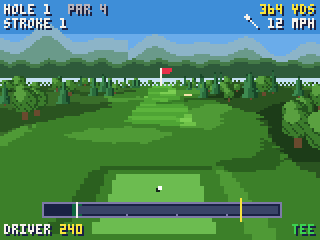
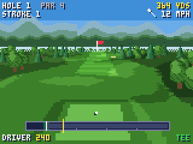
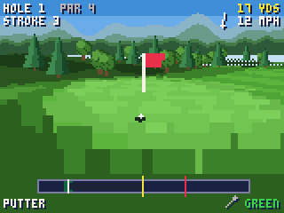
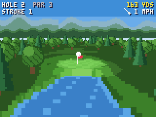

# Pocket Golf 3D



Golf over a rolling 3D landscape for the PodBox Arcade. A camera behind the ball looks down each hole, the click wheel aims, and a three-press swing meter sets the power and the accuracy. Nine holes of Meadow Links: fairways and rough, bunkers, ponds and a creek, woods along every hole, wind and sloping greens.

  

## Playing

| Control | Action |
|---|---|
| Wheel | Aim. The view stays put while the aim moves, and turns to follow it near the edge |
| Prev, Next | Choose the club |
| Select | Swing: start the meter, set the power, set the accuracy |
| Play | The hole from above, with the ball, the pin and the aim |
| Menu | Pause: Restart round, Main menu, options, high scores |

- **The swing meter.** Select sets the marker running up the meter from the line. Press again to set the power where it is: half way is half the club's distance. The marker then runs back down, and the third press sets the accuracy: on the line is straight, early (still above it) hooks to the left, late slices to the right. Miss it altogether and it's the worst slice. The green patch on the line is dead straight.
- **The aim.** With the aiming guide on (pause menu), a ring shows where a full shot with the club would land, without the wind. With it off, a mark over the horizon shows the way it points. The club's full distance from where the ball lies is next to its name.
- **The club** is chosen for each shot: the putter on the green, else the shortest club that reaches the pin, the driver only from the tee. Prev and Next change it.
- **Putts** take two presses: the power alone, always straight. The meter's scale follows the putt: the red mark is where the pin would be on a flat green. The arrow by GREEN at the bottom shows which way the green falls. Read the slope and aim off it.
- **The wind** blows from 0 to 12 miles an hour, a new wind each hole. The arrow at the top right shows which way it blows, as seen from the camera.
- **Lies.** From the rough a shot goes 85% as far, from the woods 60% and wild, from a bunker 70% (the sand wedge 95%). Rough and sand add a little hook or slice of their own.
- **Penalties.** Into the water: one stroke, dropped back from where the ball crossed the water's edge. Out of bounds (past the woods at the edge of the map): one stroke, played again from where it was. After ten strokes the ball is picked up.
- **The frame rate** option shows the frames a second; the swing meter can run slow or fast.

## The clubs

| Club | Full carry | Launch | Run after the first bounce |
|---|---|---|---|
| Driver | 240 yards | 20 degrees | 75% |
| 3 wood | 215 | 24 | 70% |
| 3 iron | 190 | 26 | 65% |
| 5 iron | 170 | 30 | 60% |
| 7 iron | 150 | 36 | 55% |
| 9 iron | 125 | 42 | 45% |
| Pitching wedge | 100 | 48 | 40% |
| Sand wedge | 70 | 54 | 35% |
| Putter | up to 60 yards | rolls | |

A driver lands running and rolls on; a wedge checks up where it lands. The driver off the ground goes 85% as far.

## Meadow Links

| Hole | Par | Yards | |
|---|---|---|---|
| 1 | 4 | 360 | Straight, three bunkers |
| 2 | 3 | 165 | Over a pond to the green |
| 3 | 5 | 505 | Bends left, three bunkers |
| 4 | 4 | 385 | Bends right, two bunkers on the left |
| 5 | 3 | 190 | Uphill, bunkers either side of the green |
| 6 | 4 | 410 | A creek across the fairway |
| 7 | 4 | 330 | Short, through thick woods |
| 8 | 5 | 520 | Two ponds down the left |
| 9 | 4 | 420 | Uphill home, three bunkers |

Par 36. The yards are along the middle of the hole, so the distance to the pin from the tee is a little more or less.

## Ways to play

- **Play 9 holes**: stroke play, every stroke counted. The scorecard comes up after each hole, and after the ninth the round goes to the Meadow Links board, low score winning.
- **Practice**: any hole, then on to the next, as long as you like. Nothing goes on the board, but a hole's best still counts.

Each hole's best and the best round are kept, and shown before each hole and on the start screen.

### Achievements

| Name | For |
|---|---|
| Early Bird | A birdie (or better) |
| Soaring | An eagle |
| Hole in One | Holing a tee shot |
| Under Par | A round under par |
| Down the Middle | Every par 4 and 5 tee shot of a round on the fairway |

## How it works

### The picture

`land.draw` on a 128 by 256 hole costs about 16,500 units even coarse, near a whole tick at 25 a second, and the trees as much again. But golf stands still between shots, so the picture is drawn only when the camera moves, into an image of the screen, and copied every tick for about a thousand units. The camera moves only on cuts: behind the ball for each shot, to where a long shot will land at the top of its flight, round to the aim when it nears the edge of the picture.

A new picture takes four ticks or so, and the screen keeps the last picture meanwhile, which the cut hides: the sky and the trees in view found (by hand: most trees are behind the camera or off to the side, and a few sums say so before anything is projected), then the land, then the trees and the flag far to near, as many a tick as the units allow. A tree costs about 170 units whatever its size, so the tiny ones far off are left out and the sky's own tree line stands in for them. A tree right by the camera is left out too.

The world wraps for `land.draw`, so the picture is drawn only as far as the map goes in the camera's direction, plus a little of the woods: past it would be the other end of the hole.

### The ball

`ball.js` runs at 25 ticks a second in world pixels (2.5 yards each). In the air the ball falls under gravity, drifts with the wind, and a hook or a slice pushes it sideways the whole way. There is no drag: each club's launch angle is a low, effective one that gives its carry and a believable height. Landing, it bounces by the surface, high off a fairway and hardly at all in a bunker, the first bounce taking the club's backspin. Then it rolls, slowed by the surface and pulled down slopes. On a green the slope is the green's own tilt from the course's data rather than the pixels', whose whole steps of a quarter pixel would roll the ball over terraces.

The trees stand in a grid of 16-pixel squares, so a low ball looks only at the nine squares round it. A crown slows and drops the ball; a trunk sends it back.

The cup is a yard across, about eight times a real one, as the picture is coarse. A ball rolling over it slower than one that would stop about three yards past drops in; faster, it lips out. A ball landing on it from the air goes in.

Fractions are 16.16 here, so care is taken with squares: distances are squared in quarters (a fraction squared past 181 would wrap), and a slow roll's speed or a gentle slope's pull is squared at 32 or 256 times, as squared they're under a fraction's smallest step. Squared as they were, a stopped ball on a green never came to rest.

### The holes

`tools/pocketgolf3d_assets.py` makes every hole: a curve from the tee to the green, the surfaces round it (fairway mown in stripes, rough, woods to the edge, an apron, the green in a check, bunkers, ponds and the creek), the heights (rolling hills, a bowl rising to the woods, the rise from tee to green, a flat tee, a tilted green, bunkers dipped), the colours with the sun's shading baked in, and the trees. Each hole is a heights picture and a colours picture, lazy in the cart, with the course's data in `data/course1.json`: par, yards, tee, pin, the tee shot's aim, the green, its tilt, and the trees two numbers each (place; ground height, own height and kind), packed because five numbers a tree took more memory to read than the cart had.

A pond lies flat below its lowest shore. The creek is flat across but follows the land along its length: flat all the way across a hole it was a trench with a three-pixel cliff a ball stuck on.

### Memory and loading

The cart's file sits in the same 512 KB as the game: its 18 hole pictures take about 200 KB of it packed. A hole's two pictures are 32 KB each when loaded, and unpacking one takes up to 16.6 KB of working memory from the free space above the topmost thing held, as the heap never moves anything. If a new picture went in at the top of that space while the old hole's were still waiting to be cleared up below it, the working memory wouldn't fit and the game would stop "out of memory". So `course.setup()` keeps a reserve of 106,000 bytes low in memory for good, which leaves the free space at the top at about 26 KB with a hole loaded: the first new picture never fits there, the engine clears up first, and the new pictures go where the old ones were. The images are made and the reserve kept before the data files are read, and nothing read from them is kept (the course's name is in the code), so what the reading leaves is all let go.

Loading a hole takes four ticks, the screen left as it was: the heights (about 24,500 units), the colours (about 18,000), the trees set out (about 17,000), and the hole set up with its map.

## Performance

At 25 ticks a second, the iPod Video playing FLAC has about 17,500 units a tick. From `tools/pocketgolf3d_test.py`, units a tick with the harness taken out:

| Ticks | Average | p95 | Max |
|---|---|---|---|
| Aiming, the swing and the ball in flight | 3,300 to 3,700 | 3,550 to 4,850 | 7,500 |
| A new picture (about four ticks a cut) | | | 20,600 |
| Loading a hole (four ticks, between holes) | | | 26,500 |

The ticks of play never reach the budget. A new picture's land tick goes a little over, as does reading a hole's heights: the screen holds the last picture through both.

## Testing

```sh
python3 tools/pocketgolf3d_test.py                  # smart, wild and input players, practice through every hole, saves
python3 tools/pocketgolf3d_test.py --seeds 1,2,3,4,5,6 --rounds 3
python3 tools/pocketgolf3d_test.py --selftest       # a rolling ball let sink into the ground: the checks must fail
```

It copies the cart to a scratch folder with `tools/pocketgolf3d_test.js` as `stress.js`, called first in `update()`, and plays it in `pbgvm`:

- **smart**: the game's aim and club, the power for the distance (a putt's for its slope too, within 4%), a little hook or slice. It goes round in 30 to 33.
- **wild**: any aim near, any club, any power, any error. It picks up every hole, finding the trees, the water and out of bounds.
- **input**: random presses and turns through `pbgvm`, so the real meter, menus and scorecard are played.
- **practice**: four times through every hole, loading each again; memory is printed at the end.
- **saves**: two rounds with a saves file, then a third: the best round, the rounds played and every hole's best must be there and read back.

Every tick it checks the scene, the club, the meter, the aim, the hole loaded, the strokes and scores, the ball (on the map, in bounds at rest, never under the ground, on it when not flying, not too fast, never at rest on water), that a shot takes no more than 1,300 ticks and a picture no more than ten in a row, and that a holed ball is at the pin with its hole's best saved. Ticks of play over 17,500 fail the run.

`tools/screenshots.py pocketgolf3d` and `tools/gifs.py pocketgolf3d` take the pictures above with the same pilot, running the swing meter as a player would (`stress_show`).

## Files

| File | What it does |
|---|---|
| `cart.json` | name, rate 25, help, the hole pictures as lazy images, three options, the board, five achievements |
| `main.js` | scenes, a round and practice, aiming, strokes and penalties, the drop, records, achievements |
| `course.js` | the holes: loading in steps, the memory reserve, the ground's height and surface, the trees' grid |
| `ball.js` | flight, wind, hook and slice, bounces, rolling, slopes, trees, the cup |
| `swing.js` | the clubs, choosing one, the three-press meter, striking |
| `view.js` | the cameras, the picture drawn in steps into its image, the trees and flag, the ball, its shadow, the aim |
| `hud.js` | the numbers, the meter, the wind and slope arrows, the hole's map, words, the panel before a hole, the scorecard |
| `title.js` | the start screen over the first hole, and how to play |
| `images/c1h<n>_h.png`, `_c.png`, `images/trees.png`, `images/sky1.png`, `palettes/golf.gpl`, `data/*.json`, `logo.png` | made by `tools/pocketgolf3d_assets.py` |
| `sounds/*.json` | sfxr settings: the meter's tick, the hit, the putt, bounces, sand, leaves, the splash, out of bounds, the cup, a lip-out, a birdie, the menus, a new hole |
