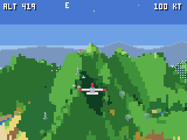
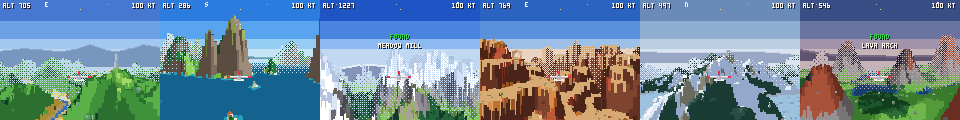

# Pocket Wings 3D



A relaxed flying game for the PodBox Arcade: a small propeller aircraft over six landscapes, with no enemies, no score and no time limit. Just fly, or go and find the landmarks.



## Flying

| Control | Action |
|---|---|
| Wheel | Bank and turn. Leave it and the wings level by themselves |
| Prev (held) | Climb, or with Follow the ground, fly higher above it |
| Next (held) | Dive, or fly lower above the ground |
| Play | Slow, cruise or fast |
| Select | The view from behind or the cockpit |
| Menu | Pause: Restart flight, Main menu, options |

With Thumb steering (pause menu) the aircraft banks toward where your thumb rests on the wheel, right or left of the top.

The ground can't hurt you. The aircraft looks at the ground under it and a little ahead (further at speed), rises smoothly when it gets close and never comes nearer than three world pixels. The world wraps: fly off one side and you come back in on the other.

The speeds change the handling a little: slow, the aircraft turns tighter and climbs less; fast, it turns wider, the wheel banks it less a click and it climbs better.

**Height** (pause menu): *Hold height* keeps the aircraft's height above the water, and Prev and Next climb and dive. *Follow the ground* is scenic flight: the aircraft keeps a height above the ground (100 to 700 m), rising and sinking with the hills by itself, and Prev and Next set that height.

## Free Flight and Discovery

Each landscape has five **landmarks**: a mill, a tower, a lighthouse, an arch, an observatory, a needle of rock and so on, thirty in all, each with its name. Fly low over one (within 160 m across and 900 m up) and it's found, in either way of flying, and saved.

- **Free Flight** is just flying.
- **Discovery** points the way to the nearest landmark not yet found: a mark on the compass strip (or an arrow beside it when it's behind you), its name and how far it is. Found, it moves on to the next. The start screen's **Landmarks** page shows what's been found in each landscape.

| Achievement | How |
|---|---|
| First Find | Find a landmark |
| Explorer | Find all five landmarks of one landscape |
| Cartographer | Find all thirty |
| World Tour | Fly for a minute over every landscape |
| Cloud Nine | Climb as high as the aircraft goes |

## The views

- **Behind**: the camera hangs a little behind and above the aircraft. The aircraft's sprite shows the bank, and its shadow follows it over the ground. A compass strip runs along the top, the height (metres above the water, or above the ground with Follow the ground) and the speed (knots) sit in the corners.
- **Cockpit**: the camera sits in the aircraft, with a panel along the bottom: height, vertical speed, an attitude display (a little horizon that tips against the bank and rises and sinks with the climb), heading and speed.

The Arcade's 3D view can't roll the picture, so the horizon stays level in a turn. Climbing and diving move the horizon up and down instead.

The engine hums, higher the faster you fly and when climbing (the pause menu can turn it off).

## The landscapes

`tools/pocketwings_assets.py` makes all six, each 256 world pixels square and seamless, because `land.draw` wraps the world. The noise is made periodic by tiling a small random lattice three by three, scaling it up and cutting out the middle. Each material has three shades, chosen by how the slope faces a sun in the north-west, so the hills have their shading for free.

| Landscape | What it is | Scenery |
|---|---|---|
| Green Valley | Rolling hills, a river that winds right round the world, two lakes, forests, fields, villages | Broadleaf trees, pines, houses |
| Coral Islands | Islands in a turquoise sea, beaches, jungle, cliffs | Palms, huts, jungle trees |
| High Alps | Broad massifs with sharp ridges, snow and glaciers on top, lakes in the valleys | Pines, chalets, rocks |
| Red Canyon | Terraced mesas in bands of red, orange and pale rock, a river deep in its canyon | Cacti, rock spires, adobe houses by the water |
| Frozen Lakes | Snowfields, frozen lakes, snowy forests, tundra | Snowy pines, cabins |
| Fire Mountains | Four volcanoes with glowing craters, ash and lava fields, green lower slopes and the sea | Trees, palms, rocks |

Every palette has the same layout, so the sky, the far hills and the scenery picture work for all six: 0 to 15 standard, seven materials in threes from 16, water, roofs and walls, the sky 42 to 45, the far hills 46 and 47, and the scenery's eight colours in three hazes from 48.

## Scenery

Billboards (`plane.billboards`) cost the iPod about five units a pixel, so the scenery and landmarks are drawn by the game, as in Powder Run 3D: projected with `plane.project` and copied out of `images/scenery.png`, which holds each of the twelve kinds at nine sizes on the screen, the smaller ones already part way into the haze. They're drawn far to near over the ground, the aircraft over them all.

- They're **gathered** a twelfth a tick in a wedge ahead of the camera, nearest first and landmarks always first (and seen from 1.8 times further). Every twelfth tick the most important become the list drawn: 24 at the finest level, 16 at the next, 5 at the quicker ones.
- `land.draw` would hide a billboard behind a hill but can't hide these, so each tick two of the list are looked at along the line from the camera: where the ground rises above that line on the way, the hill hides it until the next look.
- The game works out at the start which size to draw for each height on the screen, rather than carrying a table of them: the cart's memory is better spent on the landscapes.

## Memory and changing landscapes

A landscape is five lazy pictures, 171 KB, and the cart has about 270 KB of heap. As in Powder Run, changing landscapes keeps a reserve low in memory (40,000 bytes) so the free space at the top stays under 64 KB, which makes the engine clear up before the first new picture and puts the new pictures where the old ones were. Nothing the game keeps is put together at run time. 72 test runs of up to 200 changes each never ran short.

## The picture adjusts itself

`land.draw` is by far the dearest thing drawn. On an iPod Video playing FLAC a tick has about 12,500 units at 33 ticks a second, 17,500 at 25 and 22,800 at 20. So the picture comes in five levels:

| Level | Landscape | Ground | Far hills | Sees | Scenery | Rate | Units (behind, avg / p95) |
|---|---|---|---|---|---|---|---|
| Q0 | full size | fine | yes | 300 | 24 out to 150 | 33 | 43,900 / 46,700 |
| Q1 | full size | coarse | yes | 300 | 16 out to 140 | 33 | 31,400 / 33,200 |
| Q2 | half size | coarse | no | 220 | 5 out to 110 | 25 | 15,800 / 17,400 |
| Q3 | half size | coarse | no | 180 | 5 out to 100 | 25 | 14,900 / 16,500 |
| Q4 | half size | coarse | no | 180 | 5 out to 100 | 20 | 14,800 / 16,500 |

The **half-size landscape** is the trick that makes an iPod Video playing music work. Each landscape is also stored at 128 square with its heights halved, and the quicker levels draw that one with the camera's place halved to match. Perspective doesn't care about scale, so it's the same view of the same landscape, only coarser, for about 8,000 units less. The flying always goes by the full-size heights.

**Auto** (the default) watches the frames that run late. More than three in a second and it steps down a level. After a quiet spell it tries a level up, on trial for three seconds and watched every tick; each failed try puts the next one further off, from half a minute up to four. A level that holds for twenty seconds is remembered for the next flight. A pause doesn't count as late frames. Measured on simulated iPods:

| iPod | Settles at | Ticks over budget |
|---|---|---|
| iPod Video playing FLAC | Q2 or Q3, 25 frames a second | 0.2% to 1.8% |
| iPod Video, music stopped | Q1, 33 frames a second | 0.1% |
| iPod Classic | Q0, 33 frames a second | 0% |

The Picture option can also hold it at Fast (Q3) or Detailed (Q0). The Frame rate option shows the level and the rate on screen.

The far hills on the horizon (`plane.sky`, about 2,900 units) stand where the drawn ground ends rather than on the true horizon, which is lower on the screen the higher you fly.

## Testing

```sh
python3 tools/pocketwings_test.py                # every level from both views, Auto on three iPods, every landscape two ways
python3 tools/pocketwings_test.py --sessions     # long flights with saves, saves read back, suspend, pauses, fifty landscape changes
python3 tools/pocketwings_test.py --selftest     # no lift and no floor in a scratch copy: the checks must fail
```

The tool flies the game by itself in `pbgvm` from flight plans made from a seed: turns of the wheel, Prev and Next held (often all the way down to the hills) and Play for the speeds, through pbgvm's real input. It holds each level in turn from both views, lets Auto run on a simulated iPod Video playing FLAC, iPod Video and iPod Classic, and flies every landscape in Discovery (steering for each landmark in turn and coming down to find it, as a player would) and with Follow the ground from the cockpit. Every tick it checks that the aircraft is above the ground, the chase camera too, that the place, heading, bank, speed and the height kept above the ground are in range, that the scenery's list stays within its level's cap, that landmarks found stay found and Discovery's next one isn't one of them, and that the rate matches the level. Every Discovery run must find all five landmarks.

`--sessions` flies 30,000 ticks in every landscape with the saves kept, then checks that all five landmarks were saved with the landscape, the landscape flown and the seconds flown; that a new start reads them back; that a flight suspended half way and resumed is the same flight as one never suspended; that three pauses break nothing; and that memory holds steady through fifty changes of landscape.

For the simulated iPods `quality.js` has a `sim` setting that judges each tick by its own units (`unitsnow()` at the end of `draw()`) against that iPod's budget, instead of by `skipped()`. The game leaves it off.

## The web page

CI builds the cart as a web page too (`page: true` in `.github/workflows/build.yml`), uploaded with the cart and attached to a release beside it. The game leaves the music alone, so it plays the same in a browser. Pages would need a public repo, so the page is a file to download and open.

## Files

| File | What it does |
|---|---|
| `main.js` | The scenes, Free Flight and Discovery, finding landmarks, the engine's sound, records, options |
| `world.js` | The six landscapes: loading their pictures, palette and data safely, the ground's height, landmark names |
| `scenery.js` | Scenery and landmarks: gathering, choosing, looking past hills, drawing far to near |
| `flight.js` | The aircraft: controls, banking, climbing, speeds and their handling, Follow the ground, keeping clear of the ground |
| `view.js` | The picture: sky, far hills, ground, fog, scenery, the chase camera, the aircraft and its shadow |
| `quality.js` | The five levels of the picture and Auto |
| `hud.js` | The instruments, the attitude display, Discovery's way, the words on screen |
| `title.js` | The start screen over a flyover: the way to fly, the landscape, the landmarks found, how to fly |
| `images/*_h.png`, `*_c.png`, `*_h2.png`, `*_c2.png`, `*_sky.png`, `images/scenery.png`, `palettes/*.gpl`, `data/*.json`, `sheet.png`, `logo.png` | Made by `tools/pocketwings_assets.py` |
| `sounds/` | Tick, gear, start, found |

Saved numbers: 1 the picture's level; 2 to 7 the landmarks found in each landscape, a bit each; 8 the landscapes flown a minute in; 9 the landscape last chosen; 10 seconds flown in all.

## How it was built

1. **Phase 1**: Green Valley, flying, both views, instruments, the self-adjusting picture, the test tool.
2. **Phase 2**: an attitude display and a vertical speed in the cockpit, gentler handling at the edges of the speeds, Follow the ground.
3. **Phase 3**: the other five landscapes, each made by its own shaping in the assets script, with its own palette and far hills.
4. **Phase 4**: scenery and landmarks drawn by the game, the engine's sound, Discovery, achievements.
5. **Phase 5**: long sessions, saves, suspend and pause checks, safe landscape changes, the web page, version 1.0.

Still to do on real iPods: the budgets in `quality.js` are the manual's figures and Auto is only tested against them in simulation.
