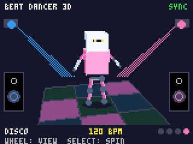
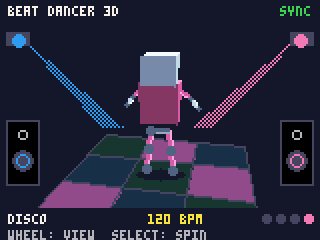
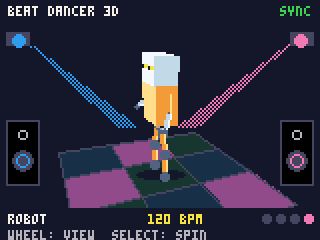

<!-- Draft for a thread in https://github.com/anthonyfletcher/podbox/discussions (category Games).
     Paste from the line under the title. The links work once the repository is public, a release is
     tagged and (for the web page) Pages is on: see docs/posts/README.md. -->

# Beat Dancer 3D: a robot that dances to your music

A small disco for your iPod: a 3D robot dances on a lit floor while moving spotlights and the speakers' lights keep time with whatever is playing. It listens for the tempo, then follows the music's clock, so every step and every tile lands on the beat. Turn the view round the dancer, pick a style (Groove, Robot or Disco, or let it change every 32 beats) and give it a spin. Your music is never changed.

**Download:** [beatdancer.pbg](https://github.com/cyberdeliaAI/podbox-games/releases/latest/download/beatdancer.pbg), from the [latest release](https://github.com/cyberdeliaAI/podbox-games/releases/latest). Copy it into the iPod's `Games` folder and choose **Arcade**.

**In the browser:** not available: a web page can't play the owner's music.

**All the games:** [cyberdeliaai.github.io/podbox-games](https://cyberdeliaai.github.io/podbox-games/), to download or play in a browser.

**Tested on:** iPod Video 5.5G. Also tested in PodBox's own VM (`pbgvm`): silent, without a beat, at 48 and 180 BPM, across playlist changes, pause and suspend, every style and view, every tick within the iPod Video's budget while playing FLAC.

**Built with:** PodBox release 2026-11-13 (Latest build).

### How to play

| Control | Action |
|---|---|
| Wheel | Turn the view round the dancer |
| Prev, Next | Groove, Robot or Disco |
| Select | A four-beat spin with raised arms |
| Play | The camera's orbit on or off |
| Menu | Pause and options |

- SYNC means it is following your music; LISTEN that it is finding the tempo, a few seconds at most; DEMO that no beat was found and it dances to its own tempo, which the options set (60 to 180 BPM).
- New tracks, seeks and coming back from pause find the beat again. Some music is followed at half or double its tempo.

**Music:** Best with music playing: it dances to its beat. Without music it dances to its own tempo.

More: [beatdancer/README.md](https://github.com/cyberdeliaAI/podbox-games/blob/main/beatdancer/README.md).

### Licence and credit

MIT licence ([LICENSE](https://github.com/cyberdeliaAI/podbox-games/blob/main/LICENSE)). Everything in it is original: the code and the art (made by the scripts in `tools/`). Source: https://github.com/cyberdeliaAI/podbox-games

Made by Cyberdelia with AI coding assistants.
