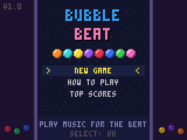
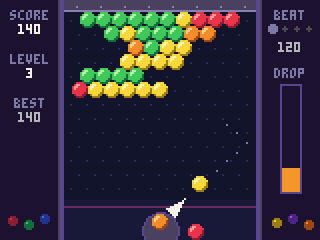
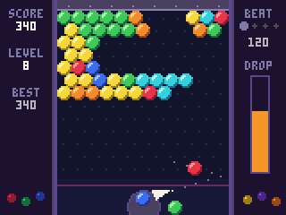

<!-- Draft for a thread in https://github.com/anthonyfletcher/podbox/discussions (category Games).
     Paste from the line under the title. The links work once the repository is public, a release is
     tagged and (for the web page) Pages is on: see docs/posts/README.md. -->

# Bubble Beat: a bubble shooter on the beat of your music

A bubble shooter whose ceiling comes down with the bars of the music you're playing. Aim with the wheel and pop groups of three or more; whatever they held up falls with them. Shoot on the beat for double, on the first beat of a bar for triple.

**Download:** [bubblebeat.pbg](https://github.com/cyberdeliaAI/podbox-games/releases/latest/download/bubblebeat.pbg), from the [latest release](https://github.com/cyberdeliaAI/podbox-games/releases/latest). Copy it into the iPod's `Games` folder and choose **Arcade**.

**In the browser:** not available: a web page can't play the owner's music.

**Tested on:** iPod Video 5.5G. Also tested at length in PodBox's own VM (`pbgvm`): played by an automatic player with its rules checked every tick, and measured against the iPod Video's budget while playing FLAC.

**Built with:** PodBox release 2026-11-13 (Latest build).

### How to play

| Control | Action |
|---|---|
| Wheel | Aim (or point with your thumb, in the pause menu) |
| Prev, Next (held) | Nudge the aim |
| Select | Shoot |
| Play | Swap your two bubbles |
| Menu | Pause: restart level, main menu, options |

- Clear the field before a bubble hangs below the line.
- Colour marks (options) tell the bubbles apart without their colours.

**Music:** Best with music playing: the ceiling follows its bars and shots on the beat score more. Without music, or with the Beat bonus off, the ceiling comes down every few shots instead.

More: [docs/bubblebeat.md](https://github.com/cyberdeliaAI/podbox-games/blob/main/docs/bubblebeat.md).

### Licence and credit

MIT licence ([LICENSE](https://github.com/cyberdeliaAI/podbox-games/blob/main/LICENSE)). Everything in it is original: the code, the art (made by the scripts in `tools/`) and the sound effects. Source: https://github.com/cyberdeliaAI/podbox-games

Made by Cyberdelia with AI coding assistants.
