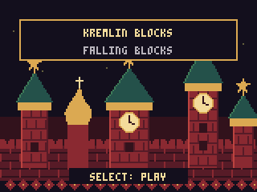
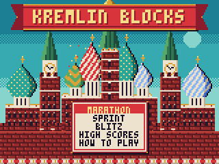
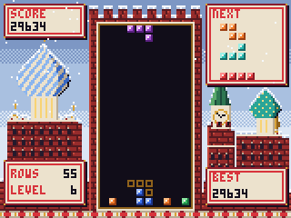

<!-- Draft for a thread in https://github.com/anthonyfletcher/podbox/discussions (category Games).
     Paste from the line under the title. The links work once the repository is public, a release is
     tagged and (for the web page) Pages is on: see docs/posts/README.md. -->

# Kremlin Blocks: falling blocks in a city of onion domes

Falling blocks for the click wheel, in a brick tower gate on the square: striped, scaled and golden onion domes, clock towers with tent roofs, the wall with its swallowtail merlons and a woven folk border. Three ways to play: Marathon (faster every ten rows, to level 20), Sprint (forty rows as fast as you can) and Blitz (the most points in two minutes). The city changes as you go, from Red Square by day through winter, sunset and the white nights to the night sky, with fireworks for four rows at once and short tunes of its own.

**Download:** [kremlinblocks.pbg](https://github.com/cyberdeliaAI/podbox-games/releases/latest/download/kremlinblocks.pbg), from the [latest release](https://github.com/cyberdeliaAI/podbox-games/releases/latest). Copy it into the iPod's `Games` folder and choose **Arcade**.

**Play in the browser:** [https://cyberdeliaai.github.io/podbox-games/kremlinblocks.html](https://cyberdeliaai.github.io/podbox-games/kremlinblocks.html)

**All the games:** [cyberdeliaai.github.io/podbox-games](https://cyberdeliaai.github.io/podbox-games/), to download or play in a browser.

**Tested on:** iPod Video 5.5G. Also tested at length in PodBox's own VM (`pbgvm`): its rules by fixtures, a game played by a placement-search pilot through real button and wheel input and replayed, pause, suspend and random input, with every tick within the iPod Video's budget while playing FLAC.

**Built with:** PodBox release 2026-11-13 (Latest build).

### How to play

| Control | Action |
|---|---|
| Wheel | Move the block, a column every four clicks |
| Prev | Rotate left |
| Next | Rotate right |
| Select | Drop it at once |
| Play, held | Drop it faster |
| Menu | Pause, options, new game, main menu |

- Full rows clear. The next three pieces are shown, and an outline marks where the block will land.
- On the start screen the wheel, Prev and Next move through the menu: Marathon, Sprint, Blitz, the high scores (the best five of each) and how to play.
- Snow and fireworks can be turned off in the options; the starting level (1 to 10) is there too.

**Music:** Nothing: your music keeps playing.

More: [kremlinblocks/README.md](https://github.com/cyberdeliaAI/podbox-games/blob/main/kremlinblocks/README.md).

### Licence and credit

MIT licence ([LICENSE](https://github.com/cyberdeliaAI/podbox-games/blob/main/LICENSE)). Everything in it is original: the code, the art (drawn by the scripts in `tools/`), the tunes and the sound effects. Source: https://github.com/cyberdeliaAI/podbox-games

Made by Cyberdelia with AI coding assistants.
