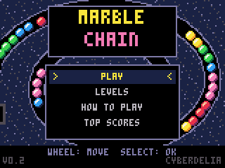
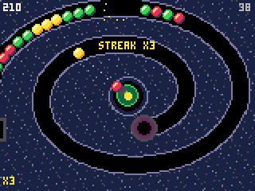
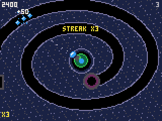

<!-- Draft for a thread in https://github.com/anthonyfletcher/podbox/discussions (category Games).
     Paste from the line under the title. The links work once the repository is public, a release is
     tagged and (for the web page) Pages is on: see docs/posts/README.md. -->

# Marble Chain: a marble shooter with six levels

A chain of marbles rolls along a winding track toward the hole. Shoot marbles into it: three or more of a colour together pop, and where the gap's two sides match the chain rolls back to close it, which can pop again for a bigger score. Six levels on three tracks, with slow, back and bomb power-ups.

**Download:** [marbles.pbg](https://github.com/cyberdeliaAI/podbox-games/releases/latest/download/marbles.pbg), from the [latest release](https://github.com/cyberdeliaAI/podbox-games/releases/latest). Copy it into the iPod's `Games` folder and choose **Arcade**.

**Play in the browser:** [https://cyberdeliaai.github.io/podbox-games/marbles.html](https://cyberdeliaai.github.io/podbox-games/marbles.html)

**All the games:** [cyberdeliaai.github.io/podbox-games](https://cyberdeliaai.github.io/podbox-games/), to download or play in a browser.

**Tested on:** iPod Video 5.5G. Also tested at length in PodBox's own VM (`pbgvm`): played by an automatic player with its rules checked every tick, and measured against the iPod Video's budget while playing FLAC.

**Built with:** PodBox release 2026-11-13 (Latest build).

### How to play

| Control | Action |
|---|---|
| Wheel | Rest your thumb on it: the gun points there (or spin the wheel, in the pause menu) |
| Select | Tap to shoot; hold it a moment to swap your two marbles |
| Play | Swap |
| Menu | Pause: restart level, main menu |

- Clear a level before the chain reaches the hole.
- Marbles with a mark carry a power-up.
- The start screen has the six levels with a picture of each track and its best score.

**Music:** Nothing: your music keeps playing.

More: [docs/marbles.md](https://github.com/cyberdeliaAI/podbox-games/blob/main/docs/marbles.md).

### Licence and credit

MIT licence ([LICENSE](https://github.com/cyberdeliaAI/podbox-games/blob/main/LICENSE)). Everything in it is original: the code, the art (made by the scripts in `tools/`) and the sound effects. Source: https://github.com/cyberdeliaAI/podbox-games

Made by Cyberdelia with AI coding assistants.
