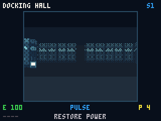
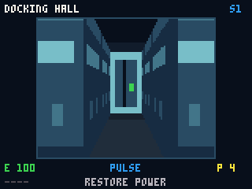
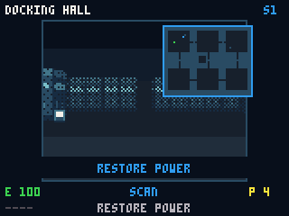

<!-- Draft for a thread in https://github.com/anthonyfletcher/podbox/discussions (category Games).
     Paste from the line under the title. The links work once the repository is public, a release is
     tagged and (for the web page) Pages is on: see docs/posts/README.md. -->

# Outpost Echo 3D: restore a silent research station

A first-person sci-fi adventure. In 2187 a maintenance shuttle reaches a research station that has stopped transmitting. Restore its five sectors, follow the crew's logs, slip past the security robots and bring the communications array back online. Progress is saved at pickups, terminals and the end of each sector.

**Download:** [outpostecho.pbg](https://github.com/cyberdeliaAI/podbox-games/releases/latest/download/outpostecho.pbg), from the [latest release](https://github.com/cyberdeliaAI/podbox-games/releases/latest). Copy it into the iPod's `Games` folder and choose **Arcade**.

**Play in the browser:** [https://cyberdeliaai.github.io/podbox-games/outpostecho.html](https://cyberdeliaai.github.io/podbox-games/outpostecho.html) (Chrome or Edge). Up and Down turn, Left walks backward, Right interacts, Enter is Select, Space is Play, Escape pauses; the drawn wheel works too.

**All the games:** [cyberdeliaai.github.io/podbox-games](https://cyberdeliaai.github.io/podbox-games/), to download or play in a browser.

**Tested on:** iPod Video 5.5G. Also tested at length in PodBox's own VM (`pbgvm`): played by an automatic player with its rules checked every tick, and measured against the iPod Video's budget while playing FLAC.

**Built with:** PodBox release 2026-11-13 (Latest build).

### How to play

| Control | Action |
|---|---|
| Wheel | Turn |
| Select | Start walking, tap again to stop |
| Prev, held | Walk backward |
| Next | Open a door, read a terminal, use a system |
| Play, tap | Use the tool |
| Play, held | Switch tools |
| Menu | Pause, settings, save |

- Hold-to-walk controls, turn sensitivity and an easier Explorer setting are in the options.

**Music:** Nothing: your music keeps playing.

More: [outpostecho/README.md](https://github.com/cyberdeliaAI/podbox-games/blob/main/outpostecho/README.md).

### Licence and credit

MIT licence ([LICENSE](https://github.com/cyberdeliaAI/podbox-games/blob/main/LICENSE)). Everything in it is original: the code, the art (made by the scripts in `tools/`) and the sound effects. Source: https://github.com/cyberdeliaAI/podbox-games

Made by Cyberdelia with AI coding assistants.
