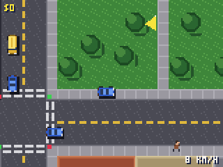
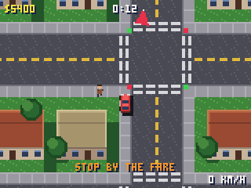
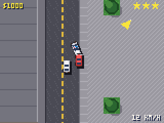

<!-- Draft for a thread in https://github.com/anthonyfletcher/podbox/discussions (category Games).
     Paste from the line under the title. The links work once the repository is public, a release is
     tagged and (for the web page) Pages is on: see docs/posts/README.md. -->

# Pocket City 3D: an open city seen from above

Drive and walk about a city of five districts on islands joined by bridges: Old Town, Downtown's towers, the gardens of Greenside, the Harbour's containers and Sunset Beach. Traffic keeps to its lanes and the lights, people walk the sidewalks, and any car is yours if you can get to it. Twenty jobs wait at the phone boxes (deliveries, taxi fares, time trials and chases), thirty tapes are lost about the city, and red lights, ramming and stolen cars bring the police, up to three stars.

**Download:** [pocketcity.pbg](https://github.com/cyberdeliaAI/podbox-games/releases/latest/download/pocketcity.pbg), from the [latest release](https://github.com/cyberdeliaAI/podbox-games/releases/latest). Copy it into the iPod's `Games` folder and choose **Arcade**.

**Play in the browser:** [https://cyberdeliaai.github.io/podbox-games/pocketcity.html](https://cyberdeliaai.github.io/podbox-games/pocketcity.html)

**All the games:** [cyberdeliaai.github.io/podbox-games](https://cyberdeliaai.github.io/podbox-games/), to download or play in a browser.

**Tested on:** iPod Video 5.5G. Also tested at length in PodBox's own VM (`pbgvm`): played by an automatic player on wheels and on foot, with the police after it and through all twenty jobs, with the city checked every tick, and measured against the iPod Video's budget while playing FLAC.

**Built with:** PodBox release 2026-11-13 (Latest build).

### How to play

At the wheel:

| Control | Action |
|---|---|
| Select, held | Throttle |
| Prev, held | Brake, then reverse |
| Wheel | Steer; let go and the wheels come back straight |
| Play, held | Handbrake, for a slide round a corner |
| Next | Get out (standing), or the horn |

On foot:

| Control | Action |
|---|---|
| Wheel | Turn |
| Select, held | Walk; with Play held as well, run |
| Next | Into the nearest car |
| Menu | Pause, the city map, options |

- Follow the yellow arrow to the next job's phone box. Lose the police first: they won't give you work while you're wanted.
- Take a car with its driver in it and they jump out and run, and the police hear of it. A paint shop in every district makes a wanted car new for $100.
- Stand still with a police car beside you and you're busted: a $200 fine, back to Old Town.
- Thumb steering (options): the front wheels, or you on foot, follow where your thumb rests.
- Your money, the jobs done and the tapes found are saved.

**Music:** Nothing: your music keeps playing.

More: [docs/pocketcity.md](https://github.com/cyberdeliaAI/podbox-games/blob/main/docs/pocketcity.md).

### Licence and credit

MIT licence ([LICENSE](https://github.com/cyberdeliaAI/podbox-games/blob/main/LICENSE)). Everything in it is original: the code, the city and the art (painted by the scripts in `tools/`) and the sound effects. Source: https://github.com/cyberdeliaAI/podbox-games

Made by Cyberdelia with AI coding assistants.
