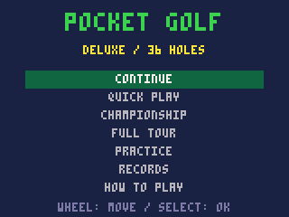
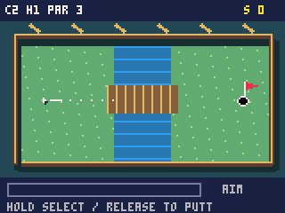
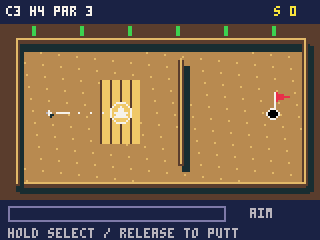

<!-- Draft for a thread in https://github.com/anthonyfletcher/podbox/discussions (category Games).
     Paste from the line under the title. The links work once the repository is public, a release is
     tagged and (for the web page) Pages is on: see docs/posts/README.md. -->

# Pocket Golf Deluxe: 36 holes of mini golf

Top-down mini golf: 36 holes on four themed courses. Sunny Gardens has sand, slopes and tunnels, Pirate Cove islands, bridges and teleporters, Desert Adventure ramps, switches and gates, Winter Wonderland ice. Quick Play, a nine-hole Championship, the Full Tour of all 36, and Practice, with low-score records for every hole and course.

**Download:** [pocketgolf.pbg](https://github.com/cyberdeliaAI/podbox-games/releases/latest/download/pocketgolf.pbg), from the [latest release](https://github.com/cyberdeliaAI/podbox-games/releases/latest). Copy it into the iPod's `Games` folder and choose **Arcade**.

**Play in the browser:** [https://cyberdeliaai.github.io/podbox-games/pocketgolf.html](https://cyberdeliaai.github.io/podbox-games/pocketgolf.html)

**Tested on:** [TODO: iPod Video (5G/5.5G), iPod Classic (6G/7G) or both, once you've played it there.] Tested at length in PodBox's own VM (`pbgvm`), played by an automatic player with its rules checked every tick, and measured against the iPod Video's budget while playing FLAC.

**Built with:** PodBox release 2026-11-13 (Latest build).

### How to play

| Control | Action |
|---|---|
| Wheel | Aim |
| Select, held | Build power; release to putt |
| Prev | Finer aim |
| Next | The aiming guide on or off |
| Play | Course overview |
| Menu | Pause, settings |

- Water returns the ball to its last dry spot, plus a stroke.

**Music:** Nothing: your music keeps playing.

More: [pocketgolf/README.md](https://github.com/cyberdeliaAI/podbox-games/blob/main/pocketgolf/README.md).

### Licence and credit

[TODO: the licence, as in the repository's LICENSE file.] Everything in it is original: the code, the art (made by the scripts in `tools/`) and the sound effects. Source: https://github.com/cyberdeliaAI/podbox-games

[TODO, your call: how it was made, as the 2048 thread does, for example "Made by Cyberdelia with AI coding assistants."]
