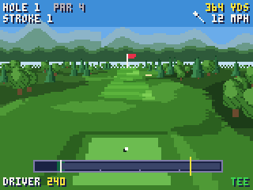
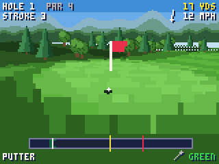
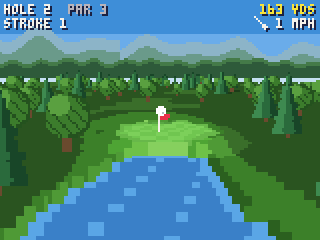

<!-- Draft for a thread in https://github.com/anthonyfletcher/podbox/discussions (category Games).
     Paste from the line under the title. The links work once the repository is public, a release is
     tagged and (for the web page) Pages is on: see docs/posts/README.md. -->

# Pocket Golf 3D: golf over a rolling 3D landscape

Golf for the click wheel, seen from behind the ball as it flies down rolling 3D holes. The wheel aims, Prev and Next choose the club, and a three-press swing meter sets the power and the accuracy: early hooks, late slices. Nine holes of Meadow Links, par 36, with fairways and rough, woods along every hole, bunkers, ponds and a creek, a new wind on each hole and greens that slope. Play a round of nine with a scorecard and a high-score board, or practise any hole.

**Download:** [pocketgolf3d.pbg](https://github.com/cyberdeliaAI/podbox-games/releases/latest/download/pocketgolf3d.pbg), from the [latest release](https://github.com/cyberdeliaAI/podbox-games/releases/latest). Copy it into the iPod's `Games` folder and choose **Arcade**.

**Play in the browser:** [https://cyberdeliaai.github.io/podbox-games/pocketgolf3d.html](https://cyberdeliaai.github.io/podbox-games/pocketgolf3d.html)

**All the games:** [cyberdeliaai.github.io/podbox-games](https://cyberdeliaai.github.io/podbox-games/), to download or play in a browser.

**Tested on:** iPod Video 5.5G. Also tested at length in PodBox's own VM (`pbgvm`): rounds played by an automatic player, a wild one and random button and wheel input, with the ball checked every tick, memory over 36 holes, the saves, and every tick of play within the iPod Video's budget while playing FLAC.

**Built with:** PodBox release 2026-11-14 (Latest build).

### How to play

| Control | Action |
|---|---|
| Wheel | Aim; the view follows near the edge |
| Prev, Next | Choose the club |
| Select | Start the swing, set the power, set the accuracy |
| Play | The hole from above |
| Menu | Pause, options, high scores |

- Select starts the marker up the meter; press again for the power (half way is half the club's distance), and once more as it comes back over the line. Putts take two presses: the red mark is where the pin would be on a flat green, and the arrow by GREEN shows which way it falls.
- A ring shows where a full shot would land without the wind; the arrow at the top right shows the wind.
- Water and out of bounds cost a stroke. After ten strokes the ball is picked up.
- The camera cuts rather than follows: behind the ball for each shot, to where a long one lands, and round when the aim nears the edge. Each cut takes a moment while the new view is drawn.

**Music:** Nothing: your music keeps playing.

More: [docs/pocketgolf3d.md](https://github.com/cyberdeliaAI/podbox-games/blob/main/docs/pocketgolf3d.md).

### Licence and credit

MIT licence ([LICENSE](https://github.com/cyberdeliaAI/podbox-games/blob/main/LICENSE)). Everything in it is original: the code, the course and the art (made by the scripts in `tools/`) and the sound effects. Source: https://github.com/cyberdeliaAI/podbox-games

Made by Cyberdelia with AI coding assistants.
