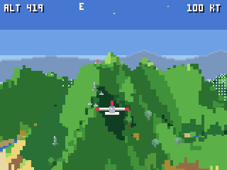
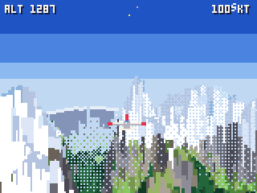
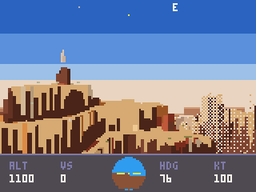

<!-- Draft for a thread in https://github.com/anthonyfletcher/podbox/discussions (category Games).
     Paste from the line under the title. The links work once the repository is public, a release is
     tagged and (for the web page) Pages is on: see docs/posts/README.md. -->

# Pocket Wings 3D: a relaxed flight over six landscapes

Fly a small aircraft over six 3D landscapes: a green valley, coral islands, high alps, a red canyon, frozen lakes and volcanoes. No enemies, no score, no hurry. Free Flight is just that; Discovery points the way to each landscape's five landmarks, thirty in all. The ground can't hurt you, and the picture adjusts itself to what your iPod can draw smoothly.

**Download:** [pocketwings.pbg](https://github.com/cyberdeliaAI/podbox-games/releases/latest/download/pocketwings.pbg), from the [latest release](https://github.com/cyberdeliaAI/podbox-games/releases/latest). Copy it into the iPod's `Games` folder and choose **Arcade**.

**Play in the browser:** [https://cyberdeliaai.github.io/podbox-games/pocketwings.html](https://cyberdeliaai.github.io/podbox-games/pocketwings.html)

**Tested on:** iPod Video 5.5G. Also tested at length in PodBox's own VM (`pbgvm`): played by an automatic player with its rules checked every tick, and measured against the iPod Video's budget while playing FLAC.

**Built with:** PodBox release 2026-11-13 (Latest build).

### How to play

| Control | Action |
|---|---|
| Wheel | Bank and turn; leave it and the wings level |
| Prev, held | Climb (or higher above the ground) |
| Next, held | Dive (or lower) |
| Play | Slow, cruise or fast |
| Select | The view from behind or the cockpit |
| Menu | Pause, options |

- Follow the ground (options) keeps a height above the hills by itself.
- On an iPod Video playing music it settles at 25 frames a second.

**Music:** Nothing: your music keeps playing.

More: [docs/pocketwings.md](https://github.com/cyberdeliaAI/podbox-games/blob/main/docs/pocketwings.md).

### Licence and credit

MIT licence ([LICENSE](https://github.com/cyberdeliaAI/podbox-games/blob/main/LICENSE)). Everything in it is original: the code, the art (made by the scripts in `tools/`) and the sound effects. Source: https://github.com/cyberdeliaAI/podbox-games

Made by Cyberdelia with AI coding assistants.
