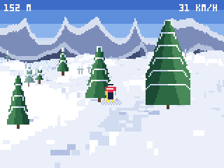
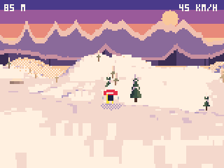
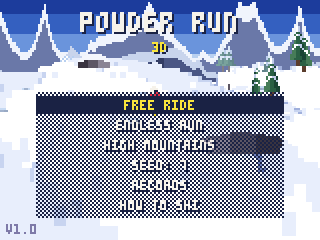

<!-- Draft for a thread in https://github.com/anthonyfletcher/podbox/discussions (category Games).
     Paste from the line under the title. The links work once the repository is public, a release is
     tagged and (for the web page) Pages is on: see docs/posts/README.md. -->

# Powder Run 3D: endless downhill skiing

Ski down a mountain that never ends, carving with the wheel between pines and boulders, over rollers that throw you in the air. Five slopes, Free Ride (for ever) and Endless Run (three falls and it's over, steeper as it goes), a board per slope, and a seed to ski the same run again.

**Download:** [powderrun.pbg](https://github.com/cyberdeliaAI/podbox-games/releases/latest/download/powderrun.pbg), from the [latest release](https://github.com/cyberdeliaAI/podbox-games/releases/latest). Copy it into the iPod's `Games` folder and choose **Arcade**.

**Play in the browser:** [https://cyberdeliaai.github.io/podbox-games/powderrun.html](https://cyberdeliaai.github.io/podbox-games/powderrun.html)

**Tested on:** [TODO: iPod Video (5G/5.5G), iPod Classic (6G/7G) or both, once you've played it there.] Tested at length in PodBox's own VM (`pbgvm`), played by an automatic player with its rules checked every tick, and measured against the iPod Video's budget while playing FLAC.

**Built with:** PodBox release 2026-11-13 (Latest build).

### How to play

| Control | Action |
|---|---|
| Wheel | Carve left or right; let go and the skis run straight |
| Next, held | Tuck, for speed |
| Prev, held | Plough, to slow down |
| Select | Jump |
| Play | Camera |
| Menu | Pause, options, top scores |

- On an iPod Video playing music it settles at 25 frames a second.

**Music:** Nothing: your music keeps playing.

More: [docs/powderrun.md](https://github.com/cyberdeliaAI/podbox-games/blob/main/docs/powderrun.md).

### Licence and credit

[TODO: the licence, as in the repository's LICENSE file.] Everything in it is original: the code, the art (made by the scripts in `tools/`) and the sound effects. Source: https://github.com/cyberdeliaAI/podbox-games

[TODO, your call: how it was made, as the 2048 thread does, for example "Made by Cyberdelia with AI coding assistants."]
