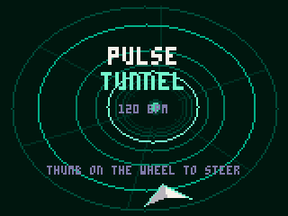
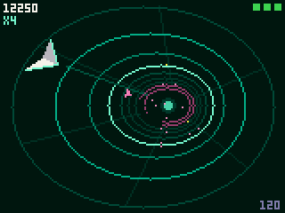
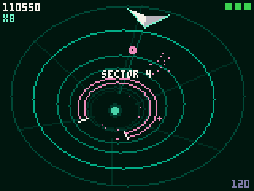

<!-- Draft for a thread in https://github.com/anthonyfletcher/podbox/discussions (category Games).
     Paste from the line under the title. The links work once the repository is public, a release is
     tagged and (for the web page) Pages is on: see docs/posts/README.md. -->

# Pulse Tunnel: a tube shooter that flies to your music

A neon tube shooter that flies to whatever is playing. The game listens for your track's tempo and plans the whole run on its beats: gates on the bar, enemies and pickups on the beat, the guns firing on the eighth notes. Steer round the tube, keep your shields up and see how far a song takes you.

**Download:** [pulsetunnel.pbg](https://github.com/cyberdeliaAI/podbox-games/releases/latest/download/pulsetunnel.pbg), from the [latest release](https://github.com/cyberdeliaAI/podbox-games/releases/latest). Copy it into the iPod's `Games` folder and choose **Arcade**.

**In the browser:** not available: a web page can't play the owner's music.

**Tested on:** [TODO: iPod Video (5G/5.5G), iPod Classic (6G/7G) or both, once you've played it there.] Tested at length in PodBox's own VM (`pbgvm`), played by an automatic player with its rules checked every tick, and measured against the iPod Video's budget while playing FLAC.

**Built with:** PodBox release 2026-11-13 (Latest build).

### How to play

| Control | Action |
|---|---|
| Wheel | Rest your thumb on it: the ship flies to where your thumb is (or spin the wheel, in the pause menu) |
| Select | Bomb: clears every enemy and spark in sight |
| Menu | Pause, options |

- The ship fires by itself, on the eighth notes of the music. You steer and choose when to bomb.
- Fly through the gap in a gate. Green pickups power up the guns, orange ones give a bomb. A new sector starts every 16 bars and the tunnel gets busier.
- Each new track is listened to for a few seconds before the run plans on its beat; no new enemies come meanwhile.

**Music:** Best with music playing: the iPod's beat tracker finds the tempo and the tunnel takes its colours from the album art. Without music the tunnel runs at 120 BPM.

More: [docs/pulsetunnel.md](https://github.com/cyberdeliaAI/podbox-games/blob/main/docs/pulsetunnel.md).

### Licence and credit

[TODO: the licence, as in the repository's LICENSE file.] Everything in it is original: the code, the art (made by the scripts in `tools/`) and the sound effects. Source: https://github.com/cyberdeliaAI/podbox-games

[TODO, your call: how it was made, as the 2048 thread does, for example "Made by Cyberdelia with AI coding assistants."]
