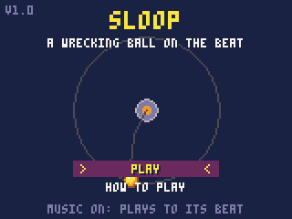
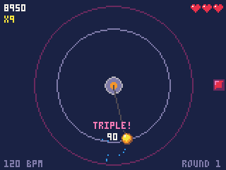
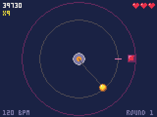

<!-- Draft for a thread in https://github.com/anthonyfletcher/podbox/discussions (category Games).
     Paste from the line under the title. The links work once the repository is public, a release is
     tagged and (for the web page) Pages is on: see docs/posts/README.md. -->

# Sloop: a wrecking ball on the beat

A wrecking ball swings on its chain round a crane in the middle of the screen, and blocks fly in from all sides to cross its ring on the beat of your music. Swing it there with the wheel: the faster it goes the harder it hits, and a red block hit on its beat takes triple damage. A round lasts a track. ("Sloop" is Dutch for demolition.)

**Download:** [sloop.pbg](https://github.com/cyberdeliaAI/podbox-games/releases/latest/download/sloop.pbg), from the [latest release](https://github.com/cyberdeliaAI/podbox-games/releases/latest). Copy it into the iPod's `Games` folder and choose **Arcade**.

**In the browser:** not available: a web page can't play the owner's music.

**All the games:** [cyberdeliaai.github.io/podbox-games](https://cyberdeliaai.github.io/podbox-games/), to download or play in a browser.

**Tested on:** iPod Video 5.5G. Also tested at length in PodBox's own VM (`pbgvm`): played by an automatic player with its rules checked every tick, and measured against the iPod Video's budget while playing FLAC.

**Built with:** PodBox release 2026-11-13 (Latest build).

### How to play

| Control | Action |
|---|---|
| Wheel | Swing the ball; it keeps going and slows down (or pull it with your thumb, in the options) |
| Play | A hard shove |
| Prev, Next (held) | Nudge it, to aim |
| Select | Start, and back to the menu after a game |
| Menu | Pause, options, top scores |

- A block that reaches the crane costs half a heart, a red one a whole heart; three hearts gone and the game is over.
- The downbeat window for the triple can be made narrower or wider in the options.

**Music:** Best with music playing: blocks land on its beats and a round lasts a track. Without music, or when no beat is found, the game keeps its own tempo, faster each round.

More: [docs/sloop.md](https://github.com/cyberdeliaAI/podbox-games/blob/main/docs/sloop.md).

### Licence and credit

MIT licence ([LICENSE](https://github.com/cyberdeliaAI/podbox-games/blob/main/LICENSE)). Everything in it is original: the code, the art (made by the scripts in `tools/`) and the sound effects. Source: https://github.com/cyberdeliaAI/podbox-games

Made by Cyberdelia with AI coding assistants.
