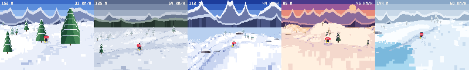

# Powder Run 3D


An endless downhill skiing game for the PodBox Arcade. A skier goes down a mountain that never ends, carving with the wheel between pines and boulders, over rollers and bumps that throw them into the air. Five slopes, two ways to ski, and a picture that adjusts itself to the iPod.



## Skiing

| Control | Action |
|---|---|
| Wheel | Carve left or right. Let go and the skis run straight, and the slope slowly turns them back down the fall line |
| Next (hold) | Tuck: less drag, more speed, wider turns |
| Prev (hold) | Plough: brake, and turn a little sharper |
| Select | Jump |
| Play | Camera: behind, or higher for a view ahead |
| Menu | Pause: Restart run, Main menu, options, high scores |

With Thumb steering (pause menu) the skier carves toward where your thumb rests on the wheel, right or left of the top. Wheel sensitivity (1 to 5) sets how far a turn of the wheel carves.

- Steep snow is fast and flat snow slow. Sharp turns, the air and ploughing hold the speed back; tucking lets it run.
- The skier never turns more than 75 degrees off the fall line, so they always go on downhill and never get stuck.
- Where the snow falls away faster than gravity can follow, over a roller or off a steep drop, the skier flies until they meet it again. The legs soak up the small bumps. In the air the skis can't bite, but a twist of the body still turns a little.
- Running into a pine or a boulder puts the skier down: they slide aside, lie a moment and get up facing down the fall line, past what they hit, with a moment's grace before anything can stop them again. A jump clears a boulder, and the small pines if it's high enough.
- Carving hard, ploughing and landing throw up puffs of snow. The skis hiss on the snow, louder and higher the faster they go (the pause menu can turn it off).

## Two ways to ski

- **Free Ride** goes on for ever. A fall costs a moment and the run goes on. The forests are a little thinner than they could be.
- **Endless Run** is scored on distance. The third fall ends it. It starts with fewer trees than Free Ride and gets thicker with them as it goes, until every pine and boulder of the slope is there at about 2,750 m; the mountain gets 0.01 steeper every 500 m, up to 0.08. Each slope has its own high-score board ("Endless: Alpine Valley" and so on), kept with the seed of the run.

The start screen picks the slope and the **seed**. A seed makes a run repeatable: which way the fall line runs across the picture, where the mountain steepens and which pines and boulders are there. "New each run" picks one at random and shows it at the start and on the end panel, so a good run can be skied again.

## The slopes

| Slope | Snow | Steepness (rise over run) | What's on it |
|---|---|---|---|
| Alpine Valley | Broad swells, rollers in places, moguls in others, ice in the hollows | 0.14 to 0.38 | Groves of pines, a few boulders |
| Winter Forest | Gentle, soft powder that holds the skis back a little more | 0.10 to 0.28 | Thick forest, overcast sky, dark hills |
| High Mountains | Big relief, high rollers, rock on the steep pitches | 0.18 to 0.48 | Boulders everywhere, few pines, jagged peaks |
| Sunset Ridge | Long rollers | 0.14 to 0.38 | Pines in warm light, a low sun |
| Frozen Wilderness | Wide sheets of ice: fast, and slow to brake on | 0.12 to 0.34 | Sparse frosted pines and boulders |

A run starts in a clear lane down the fall line, either way, so nobody falls in the first seconds.

## Records and achievements

The start screen's **Records** page keeps the distance skied in all, the top speed, the longest jump, the longest run without a fall, the best Endless Run, the jumps made and the slopes skied (500 m or more on each). The high-score boards are in the pause menu.

| Achievement | How |
|---|---|
| First Kilometre | Ski 1 km in one run |
| Speed Demon | Reach 110 km/h |
| Big Air | Stay in the air for a whole second |
| Clean Run | Ski 3 km without a fall |
| Endurance | Ski 5 km in an Endless Run |
| Grand Tour | Ski 500 m or more on all five slopes |

The records are saved every half minute or so, at every kilometre, at the end of a run and when the owner quits.

## How the endless mountain works

`land.draw` wraps the world: its picture repeats every 256 pixels both ways. No wrapping picture can go downhill for ever, so the picture holds only the relief of the snow (bumps, rollers, moguls, hollows), and the mountain's slope is added by the game.

- **In the physics**: gravity pulls along the way the skier faces by the mountain's slope times how much they face down the fall line, less the snow's own rise ahead. The ground under the skier falls by the relief's change less the mountain's drop over the ground covered, which decides when they fly.
- **In the picture**: looking down a slope is the same as looking at level ground with the head tipped up by its angle, which lowers that ground's horizon on the screen by the focal length times the slope. So the sky and its mountains stay on the level horizon, and the snow's horizon sits below it by the slope as the camera faces it. The snow drops away into the haze, the mountains stand across the valley, and the horizon moves as the mountain steepens and as the skier turns across it.
- **The fall line** runs three across for every eight down the picture (or eight up, by the seed), so a straight run crosses it at a slant and only comes back over the same snow after about 2,000 world pixels, a kilometre.
- **The steepness** changes slowly with the distance skied, from smooth noise seeded by the run, between each slope's bounds.

The camera hangs behind and above the skier, its heading and height eased so the moguls don't shake it, and never below the snow under it. When the skier drops into a dip below a camera up on a bump, the camera tips down to keep them in view.

`land.height` gives each pixel's height whole, which would make the snow a staircase under the skis and throw the skier into the air at every step. The game blends the four pixels round the skier instead.

## Pines and boulders

Billboards (`plane.billboards`) cost the iPod about five units a pixel: a single 16 by 16 skier came to 1,250 units, and a forest of them blew the budget on every level. So the game draws them itself:

- `images/objects.png` holds each kind (small pine, large pine, boulder) at a run of sizes on the screen, 2 to 64 pixels tall. The game projects an object's foot with `plane.project` (about 20 units) and copies the size nearest what the distance asks for (about 0.5 units a pixel). The smaller sizes are already part way into the haze, so trees fade with the distance for nothing.
- They are drawn far to near after the snow, the skier among them by distance. They don't hide behind the snow's rises as billboards would; on a slope seen from above and behind that hardly shows.
- What stands right by the camera, or between the camera and the skier and in the way, is left out.

Looking at every object every tick would cost thousands of units, so they are **gathered** a slice at a time: each tick looks at an eighth of them and keeps those in a wedge ahead of the skier, with how much each matters (how far ahead, plus how far off the skier's line, doubled). Every eighth tick the most important become the list that is drawn and that the skier can run into, as many as the picture's level allows (24 at the finest, 6 at the quickest). Nothing can be run into that isn't drawn, and what stands in the skier's way always comes first, so the quicker levels show fewer trees off to the sides, not fewer in the way.

Objects are placed by `tools/powderrun_assets.py` in groves of three to seven with open snow between, plus lone pines and boulders, none on the ice and a lane clear from the start. A seed gives each a rank; Free Ride keeps 55% to 80% of them by slope, Endless Run starts at 45% and brings the rest in as it goes, each only once it is out of sight.

## Memory and changing slopes

A slope is five lazy pictures, 176 KB, and the cart has about 270 KB of heap. Changing slopes lets the old ones go and loads the new. The engine reads a lazy picture through working memory taken from the free space at the top of memory, after the picture has its place; if the old slope's pictures were let go but not yet cleared up, a new 64 KB picture could land at the top and leave too little above it, and the game would stop "out of memory". Two things make it safe:

- `slope.setup()` keeps 28,000 bytes low in memory for good, so the free space at the top is always under 64 KB: the first picture of a new slope never fits there, the engine clears up first, and the new pictures go where the old ones were.
- Nothing the game keeps is put together at run time: the words on screen are kept as fixed texts and numbers. A kept string high in memory would leave too little room above it.

`tools/powderrun_test.py --sessions` changes slopes fifty times in a run to check it; 72 such runs with different seeds and timings, up to 200 changes each, never ran short.

## The picture adjusts itself

Same scheme as Pocket Wings 3D: five levels, the quicker ones drawing the half-size slope (128 square, heights halved) with the camera's place halved. The sky strip is one opaque copy, so every level has it.

| Level | Slope | Ground | Sees | Trees | Rate | Units (avg / p95) |
|---|---|---|---|---|---|---|
| Q0 | full size | fine | 200 | 24 out to 130 | 33 | 38,100 / 40,000 |
| Q1 | full size | coarse | 200 | 16 out to 120 | 33 | 28,100 / 29,800 |
| Q2 | half size | coarse | 140 | 7 out to 100 | 25 | 16,100 / 17,200 |
| Q3 | half size | coarse | 130 | 6 out to 90 | 25 | 15,500 / 16,500 |
| Q4 | half size | coarse | 130 | 6 out to 90 | 20 | 15,500 / 16,600 |

Auto, on simulated iPods (three carving plans of 6,000 ticks each):

| iPod | Settles at | Ticks over budget |
|---|---|---|
| iPod Video playing FLAC | Q3 (Q2 to Q4), 25 frames a second | 0.2% to 1.3% |
| iPod Video, music stopped | Q0, 33 frames a second | 0% |
| iPod Classic | Q0, 33 frames a second | 0% |

Auto's trials of the level above cost most of the late ticks on the iPod Video playing FLAC; a late tick there is one frame in a hundred.

## Testing

```sh
python3 tools/powderrun_test.py                  # every level, Auto on three iPods, every slope both ways
python3 tools/powderrun_test.py --sessions       # long runs, saves read back, suspend, pauses, fifty slope changes
python3 tools/powderrun_test.py --selftest       # the skier sinks through the snow in a scratch copy: the checks must fail
```

The tool skis the game by itself in `pbgvm` from plans made from a seed (S-turns of every size, hard turns held, straight runs, jumps, tucks, ploughing, the camera), played in through pbgvm's wheel and buttons. A "dodge" run also steers round what's ahead, as a player watching the snow would; a "blind" one doesn't. Every tick it checks that the skier stays on the picture, within 75 degrees of the fall line, between the lowest and highest speed, never under the snow, never going back up the mountain, on the screen and not in the air too long; that the camera stays above the snow; that a fall only ever comes from something drawn the frame before, never during the grace after getting up, and that the skier gets up again; that the list never holds more than its level allows; and that the rate matches the level.

What it found on the five slopes, Auto on the iPod Video playing FLAC, 6,000 ticks (four minutes) a run:

| | Free Ride, dodging | Endless Run, dodging | Free Ride, blind |
|---|---|---|---|
| Distance | 1.6 to 3.0 km | 1.6 to 3.6 km | 1.9 to 2.0 km |
| Falls | 0 to 4 | 0 to 2 in the run going; some Alpine and Forest runs end at 1.8 to 2.0 km | 11 to 18 |
| Speed | 25 to 47 km/h on average, up to 83 to 113 | the same | 27 to 29, up to 110 |

`--sessions` skis 40,000 ticks (about 27 minutes at 25 frames a second) on every slope both ways with the saves kept, then checks that the saved total matches the distance skied, that a new start reads the slope and records back, that a run suspended half way and resumed is the same run as one never suspended, that three pauses break nothing, and that memory holds steady through fifty changes of slope.

## The web page

CI builds the cart as a web page too (`page: true` for Powder Run in `.github/workflows/build.yml`), uploaded with the cart and attached to a release beside it. The game leaves the music alone, so it plays the same in a browser. Pages would need a public repo, so the page is a file to download and open. To make it locally, `pbgc html powderrun` needs the SDK's development packages (`npm ci` without `--omit=dev`).

## Files

| File | What it does |
|---|---|
| `main.js` | The scenes, the two ways to ski, the records, the snow's hiss and spray, the options and the order of things |
| `slope.js` | The five slopes: their pictures, memory, the snow's height (blended), the fall line, the seed and how steep it is |
| `objects.js` | Pines and boulders: gathering, choosing, drawing far to near, what the skier runs into |
| `skier.js` | The skier: carving, tucking, ploughing, jumping, gravity, friction, flying and landing, falling and getting up |
| `view.js` | The picture: sky strip, slope, fog, the camera and the horizon, the skier and their shadow |
| `quality.js` | The five levels of the picture and Auto, as in Pocket Wings |
| `hud.js` | Distance, speed, skis left, words on screen, the frame rate, the end panel |
| `title.js` | The start screen over a demo run: the slope, the seed, records, how to ski |
| `images/*_h.png`, `*_c.png`, `*_h2.png`, `*_c2.png`, `*_sky.png`, `images/objects.png`, `palettes/*.gpl`, `data/*_objects.json`, `data/objects.json`, `sheet.png`, `logo.png` | Made by `tools/powderrun_assets.py` |
| `sounds/` | Tick, start, land, jump, crash, run over |

## How it was built

1. **Phase 1**: one slope, the skier, carving, gravity, the snow under the skis, the self-adjusting picture, the test tool.
2. **Phase 2**: jumping, tucking and ploughing, pines and boulders drawn by the game, falling and getting up, sounds, the second camera.
3. **Phase 3**: the other four slopes, each with its own relief, objects, sky strip and palette; seeds.
4. **Phase 4**: Free Ride and Endless Run, high-score boards, records and achievements, wheel sensitivity, snow spray, the hideable HUD.
5. **Phase 5**: long sessions, saves, suspend and pause checks, safe slope changes, the web page, version 1.0.

Still to do on real iPods: the budgets in `quality.js` are the manual's figures and Auto is only tested against them in simulation.
