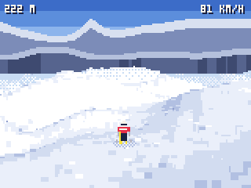

# Powder Run 3D

An endless downhill skiing game for the PodBox Arcade. A skier goes down a mountain that never ends, carving with the wheel, over bumps and rollers that throw them into the air. No pressure: just snow, mountains and the ride.

This is phase 1 of the plan below: one slope (Alpine Valley), the skier seen from behind, gravity down the mountain, carving, the snow's bumps under the skis and a picture that adjusts itself to the iPod. No obstacles yet.

## Skiing

| Control | Action |
|---|---|
| Wheel | Carve left or right. Let go and the skis run straight, and the slope slowly turns them back down the fall line |
| Menu | Pause: Restart run, Main menu, options |

With Thumb steering (pause menu) the skier carves toward where your thumb rests on the wheel, right or left of the top.

- Steep snow is fast and flat snow slow. Sharp turns and the air hold the speed back.
- The skier never turns more than 75 degrees off the fall line, so they always go on downhill and never get stuck.
- Where the snow falls away faster than gravity can follow, over a roller or off a steep drop, the skier flies until they meet it again. The legs soak up the small bumps. In the air the skis can't bite, but a twist of the body still turns a little.
- The top corners show the distance down the mountain and the speed; the pause menu can hide them.

## How the endless mountain works

`land.draw` wraps the world: its picture repeats every 256 pixels both ways. No wrapping picture can go downhill for ever, so the picture holds only the relief of the snow (bumps, rollers, moguls, hollows), and the mountain's slope is added by the game.

- **In the physics**: gravity pulls along the way the skier faces by the mountain's slope times how much they face down the fall line, less the snow's own rise ahead. The ground under the skier falls by the relief's change less the mountain's drop over the ground covered, which decides when they fly.
- **In the picture**: looking down a slope is the same as looking at level ground with the head tipped up by its angle, which lowers that ground's horizon on the screen by the focal length times the slope. So the sky and its mountains stay on the level horizon, and the snow's horizon sits below it by the slope as the camera faces it. The snow drops away into the haze, the mountains stand across the valley, and the horizon moves as the mountain steepens and as the skier turns across it.
- **The fall line** runs three across for every eight down the picture, so a straight run crosses it at a slant and only comes back over the same snow after about 2,000 world pixels, a kilometre.
- **The steepness** changes slowly with the distance skied, between about 8 and 21 degrees, from smooth noise.

The camera hangs behind and above the skier, its heading and height eased so the moguls don't shake it. When the skier drops into a dip below a camera up on a bump, the camera tips down to keep them in view.

`land.height` gives each pixel's height whole, which would make the snow a staircase under the skis and throw the skier into the air at every step. The game blends the four pixels round the skier instead.

## The slope

`tools/powderrun_assets.py` makes Alpine Valley: broad bumps, rollers straight across the fall line in some places (they repeat along it, three across for eight down, so they join seamlessly), moguls in others, and hollows of ice. The snow comes in five shades from a sun in the north-west, with its shading made gentler than its shape as snow scatters light, and a fine grain to see the speed by. Rock shows only on the steepest pitches.

The sky and its mountains are one strip, 256 wide for a whole turn, with no clear pixel: it's copied to the screen whole for a few hundred units, where `plane.sky` would cost about 2,900, so every level of the picture has it. The far range has snow on its tops and its foot in the haze, the near range a sunlit and a shaded face.

## The picture adjusts itself

Same scheme as Pocket Wings 3D: five levels, the quicker ones drawing the half-size slope (128 square, heights halved) with the camera's place halved.

| Level | Slope | Ground | Sees | Rate | Units (avg / p95) |
|---|---|---|---|---|---|
| Q0 | full size | fine | 200 | 33 | 32,900 / 33,600 |
| Q1 | full size | coarse | 200 | 33 | 23,200 / 23,900 |
| Q2 | half size | coarse | 200 | 25 | 14,700 / 15,300 |
| Q3 | half size | coarse | 150 | 25 | 13,400 / 14,000 |
| Q4 | half size | coarse | 150 | 20 | 13,400 / 14,000 |

Auto, on simulated iPods (four carving plans of 9,000 ticks each):

| iPod | Settles at | Time there | Ticks over budget |
|---|---|---|---|
| iPod Video playing FLAC | Q2, 25 frames a second | 98% | 0.1% |
| iPod Video, music stopped | Q0, 33 frames a second | 96% | 0% |
| iPod Classic | Q0, 33 frames a second | 96% | 0% |

So the concept's target holds: 25 frames a second on an iPod Video playing music, 33 elsewhere.

## Testing

`python3 tools/powderrun_test.py` skis the game by itself in `pbgvm` from carving plans made from a seed (S-turns of every size, hard turns held, straight runs), played in through pbgvm's wheel. Every tick it checks that the skier stays on the picture, within 75 degrees of the fall line, between the lowest and highest speed, never under the snow, never going back up the mountain, on the screen and not in the air for too long; that the camera stays above the snow; and that the rate matches the level. It reports each level's units, Auto on three simulated iPods and the skiing itself:

| | |
|---|---|
| Distance in 6 minutes | 3.7 to 3.9 km |
| Speed | 38 to 39 km/h on average, up to 93 to 100 |
| Jumps (6 ticks or more in the air) | 120 to 140, one every three seconds or so; the longest about 0.7 s |

`--selftest` lets the skier sink through the snow on landing in a scratch copy to show the checks catch it.

## Files

| File | What it does |
|---|---|
| `main.js` | The scenes, the options and the order of things |
| `slope.js` | The mountain: its pictures, the snow's height (blended), the fall line and how steep it is |
| `skier.js` | The skier: carving, gravity, friction, flying and landing, distance and speed |
| `view.js` | The picture: sky strip, slope, fog, the camera and the horizon, the skier and their shadow |
| `quality.js` | The five levels of the picture and Auto, as in Pocket Wings |
| `hud.js` | Distance, speed, frame rate |
| `title.js` | The start screen over a demo run, and how to ski |
| `images/alpine_*.png`, `palettes/alpine.gpl`, `sheet.png`, `logo.png` | Made by `tools/powderrun_assets.py` |
| `sounds/` | Tick, land and start |

## The plan from here

1. **Phase 1, done**: one slope, the skier, carving, gravity, the snow under the skis, the self-adjusting picture, the test tool.
2. **Phase 2**: jumping on Select, braking (Prev) and tucking (Next), turning animations, trees and rocks as billboards with collisions, falling and getting up, distance records and sounds.
3. **Phase 3**: the other slopes (Winter Forest, High Mountains, Sunset Ridge, Frozen Wilderness), each with its own relief, objects, sky strip and palette; seeds.
4. **Phase 4**: Free Ride and Endless Run, high scores and saved records, control sensitivity, a hideable HUD (there now), better animations, snow spray.
5. **Phase 5**: testing on iPods, with and without music, and release; a browser page where the Arcade allows it (the game leaves the music alone, so it can be exported; Pages needs a public repo).

Still to find out, as for Pocket Wings: how `plane.billboards` stands sprites on `land.draw`'s relief, and what trees cost on top of the half-size slope.
