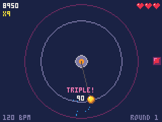

# Sloop



A wrecking ball on the beat, for the PodBox Arcade. The ball swings on its chain round a crane in the middle of the screen, and blocks fly in from all sides to cross its ring on the beats of the music playing on the iPod. Swing the ball there on the beat: the faster it goes the harder it hits, and a red block hit on its downbeat takes triple damage. ("Sloop" is Dutch for demolition.)

## Playing

| Control | Action |
|---|---|
| Wheel | Swing the ball: with the clock, it swings with the clock. It keeps going after you stop, slowing down |
| Play | A hard shove the way it's going, then a moment before the next |
| Prev / Next (held) | Nudge it against or with the clock, to aim |
| Select | Start, and back to the menu after a game |
| Menu | Pause: Restart game, Main menu, options, high scores |

With Thumb steering (pause menu) the ball is pulled toward where your thumb rests on the wheel instead, still on its chain and still with its momentum.

- Each block crosses the ball's ring exactly on a beat, then keeps coming toward the crane. Be at it when it lands. Within a beat or two of landing, a mark on the ring shows where, and the block lights up just before.
- The ball hits with its speed: 1 slow, up to 3 at full swing. Small blue blocks take one, red ones (on the bar's first beat) two (three from round 4), gold ones one. A red block hit within 120 ms of its beat takes **triple** damage (the Downbeat window option makes that 80 or 180).
- What survives a hit is knocked back out and the ball bounces off it.
- Every block smashed adds to the combo (a gold one adds three), up to x9; a smash scores 10 times the damage times the combo, a gold one double. A block that gets past the ring resets the combo.
- A block that reaches the crane costs half a heart, a red or gold one a whole heart, and the crane is shielded for a moment after. Three hearts gone and the game is over.

## Rounds and the music

A round lasts a track. When the next track starts the round is cleared: a bonus of 50 points for each half heart kept times the round, and a heart back. The game then listens for the new track's tempo.

- **Listening**: the beat tracker costs about 6,300 units a tick, so the game listens only until the tempo is held (confidence 60 and the downbeat known), at 25 ticks a second meanwhile, then predicts the beats for nothing. While it listens the ball can be swung but no blocks come.
- **No beat found** within ten seconds: the game plays to its own metronome and listens once more twenty seconds later. If it finds the beat then, it takes over without a jolt: everything in the air keeps its place.
- **No music**, or the Play to the music option off: the metronome all along, 100 BPM in the first round and 6 faster each round after (up to 136), a round 32 bars.
- **Fast music**: beats shorter than 380 ms are taken two at a time.
- A **seek** clears the air and listens again; a pause in the music hands over to the metronome.

How busy a bar is follows the round and the music's energy (`beat.mood`): one to four blocks a bar, never more than the round plus one. The first four bars of a game bring only the red ones, to learn on. Each block lands an eighth of a turn round from the last for every beat between them, always the same way round, and the way turns back every two bars, so the ball can follow the pattern by swinging; busy music (high flux) makes the steps half again as long. A gold block comes every eight bars.

## Achievements

| Achievement | How |
|---|---|
| On the One | Smash a red block on its beat for triple damage |
| Full Combo | Reach a combo of 9 |
| Gold Rush | Smash five gold blocks in one game |
| Clean Round | Clear a round without losing a heart |
| Encore | Reach round 5 |
| Wrecking Crew | Smash 200 blocks in one game |

## How it works

- **The ball** (`ball.js`) is a pendulum the player keeps swinging: an angle and a speed in turns a tick, pushed by wheel clicks, damped by 1.5% a tick, at most 0.056 turns a tick (a full turn in 18 ticks). Everything scales with the rate, so it plays the same at 25 and 33.
- **The blocks** (`blocks.js`) are planned a beat at a time, a full flight (2 seconds) ahead, for beats from `rhythm.next()`. A block's place is worked out from the clock every tick, never stepped: off the screen 2 seconds before its beat, on the ring on the beat, at the crane 0.7 seconds after. So it lands on the beat at any rate.
- **The clock** (`rhythm.js`) is the track's (`beat.clock()`) while the tempo is held, the game's own (counted in ticks) otherwise. When it changes, `blocks.shift()` moves everything in the air by the difference.
- Ms are whole numbers that pass 32767 after half a minute, so they're never mixed with fractions except as small differences: a block's radius is the share of its flight left (under 2 seconds) times the pixels.
- Fixed arrays of 12 block slots; the splinters are an engine particle pool. Nothing kept is made in play.

## Performance

`python3 tools/sloop_stress.py`, 9,000 ticks a run, units a tick with the harness taken out:

| Player | Avg | p95 | Max |
|---|---|---|---|
| Smart (swings for every block, triples the red ones) | 4,900 | 5,500 | 7,000 |
| Blind (the wheel at random) | 4,700 | 6,300 | 7,000 |
| Still | 4,700 | 6,200 | 6,900 |
| While listening for the tempo (at 25 a second, budget 17,500) | | | 14,700 |

Well inside 12,500 at 33 ticks a second on an iPod Video playing FLAC, and inside 17,500 at 25 while listening.

## Testing

```sh
python3 tools/sloop_stress.py                     # smart, blind and still; no music, a steady beat and tracks
python3 tools/sloop_stress.py --modes smart --music tracks --seeds 1,2,3 --ticks 40000
python3 tools/sloop_stress.py --selftest          # a block's count forgotten in a scratch copy: the checks must fail
```

Every tick it checks: hearts 0 to 6 halves, the combo 1 to 9, the points never going down in a game, every block's strength, kind, angle and radius in range and none past the ring left unmissed, the block count matching the blocks, no block while the game waits for the tempo, the ball's angle and speed in range, the rate 25 while listening and 33 otherwise, and no listening beyond its time.

The smart player swings for the block landing next. A red one it waits a tenth of a turn short of and swings through on the beat. In 9,000 ticks it smashes about 280 blocks, 115 to 135 of them triples, and loses at most half a heart; with tracks over 40,000 ticks it reached round 5. The still player loses a game in about 9 seconds, the blind one barely better. How hard it is for people on an iPod is still to find out.

## Files

| File | What it does |
|---|---|
| `main.js` | The scenes, rounds, scoring, hearts, shield and shake, achievements |
| `ball.js` | The wrecking ball: swinging, the shove, nudges, Thumb steering, the chain |
| `blocks.js` | The blocks: planning on the beats, flight, meeting the ball, damage and triples, splinters |
| `rhythm.js` | The clock and the beats: listening, the tracker's predictions, the metronome, track changes |
| `hud.js` | Points, combo, hearts, tempo and round, words on screen, the panels |
| `title.js` | The start screen over the ball swinging by itself, and how to play |
| `sheet.png`, `logo.png` | Made by `tools/sloop_assets.py` |
| `sounds/` | Tick, start, stamp, smash, heavy, triple, gold, dent, heart, clear, over |

Saved numbers: 1 the furthest round reached, 2 blocks smashed in all. The high scores are the `points` board.

The concept this came from called for a pause-menu course cut from the music's hits (`beat.ahead`), which keeps the tracker listening the whole game; it isn't in, as it would cost a third of the iPod's time throughout.
