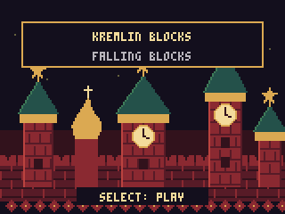

# Kremlin Blocks

An original falling-block game for PodBox Arcade, with a Russian-inspired
pixel-art style. Red-brick walls, green spires, a clock tower, a golden
onion dome and geometric borders frame the board. The skyline is newly
drawn by the asset generator. It isn't copied game art or a photograph.



The well is 10 columns by 20 rows. Complete horizontal rows to clear them.
Seven four-cell pieces arrive from shuffled bags, so every group of seven
contains each kind once. The next three pieces and a landing outline help
with planning. Every ten cleared rows increases the level, up to twenty.
There are high scores, lifetime cleared rows and four achievements.

## Controls

| Control | Action |
| --- | --- |
| Wheel | Move horizontally, one column per four clicks |
| Prev | Rotate left |
| Next | Rotate right |
| Select | Hard drop and lock |
| Hold Play | Soft drop |
| Menu | Native pause, options, new game and main menu |

A held Select can't drop another block. Buttons held through the title or
a pause are consumed until release. Rotation has small horizontal kicks
and a short floor kick. The long piece can kick up two rows. These are
this game's own rules, rather than an exact implementation of guideline
SRS. Ground contact gives 350 ms to adjust, with at most eight grounded
movement resets. Hidden cells above the well may be used while spawning.
A piece that locks above the top ends the round without writing debris.

Options toggle sound, the landing guide and a performance overlay. The
starting level, from one to ten, applies to the next game. The game never
controls the owner's music. Its short original tone effects are optional.

## Scoring and progress

Single, double, triple and four-row clears award 100, 300, 500 and 800
points times the current level. Consecutive clearing blocks add a combo
bonus. A hard drop gives two points per row and a soft drop gives one.
The native high-score board keeps the best finished rounds.

Achievements reward four rows at once, forty lines in one game, five
consecutive clearing blocks and reaching level ten. `dget(0)` keeps the
best score and `dget(1)` keeps lifetime cleared rows. The cart ID is stable
and independent of every other game. Native pause-menu Quit retains the
VM for Continue, including the bag, board, active piece and cached image.
Returning to the main menu or choosing New game abandons the current run.

## Build and verify

Use the sibling SDK at `../podbox/arcade/sdk`. Install its Node dependencies
and build `host/pbgvm` with `sh host/build.sh`, as its README describes.
Only this cart is built by these commands:

```sh
mkdir -p dist
node ../podbox/arcade/sdk/pbgc.js build kremlinblocks -o dist/kremlinblocks.pbg
python3 tools/kremlinblocks_test.py --keep dist/kremlinblocks-checks
python3 tools/kremlinblocks_test.py --selftest
```

The test copies the cart to temporary folders. Its placement-search pilot
uses the real collision rules, then drives rotation buttons, wheel clicks
and hard drops. Its trace replays against a cart without the pilot and
against the uninstrumented cartridge. It must clear at least 100 rows,
earn the four-row and forty-line achievements and reproduce the same game
states. A measured 9,000-tick run clears 364 rows over two rounds and earns
all four achievements.

Fixtures test bag fairness, boundaries, hidden spawn and lock-out, wall
and floor kicks, blocked rotation, one to four simultaneous clears, row
compaction, scores, bounded lock resets and blocked spawning. The probe
checks every row count, cell value, active collision, landing guide and
piece state. Fault injection corrupts row counts and must be caught.
Other checks cover held buttons, pause, VM snapshot restoration, owner's
music, fast random input, skipped draws and a high starting level.

Build a self-contained browser file and test the official WASM runtime:

```sh
node tools/kremlinblocks_web.mjs
python3 tools/kremlinblocks_test.py --browser-runtime dist/kremlinblocks-runtime.wasm --keep dist/kremlinblocks-checks
```

The exporter needs the SDK's `esbuild` development dependency. It downloads
a pinned official WASM runtime, checks its checksum and embeds the cart,
player and licence notices. The finished HTML has no external runtime
requirements. The exporter accepts `--sdk`, `--out`, `--runtime` and
`--esbuild`. Test and preview tools accept `--sdk`. `SDK` also overrides the
default SDK path. Browser WASM must reproduce the complete native replay.

The independent `.github/workflows/kremlinblocks.yml` builds both formats,
runs these checks and uploads workflow artifacts. It pins SDK commit
`126ebba20eb4f650d98ec03e6838d226af2e7013`. It doesn't publish a release or
change the shared workflows. `sh build.sh` discovers the cart too.

## Art and previews

```sh
python3 -m pip install 'Pillow==12.3.0'
python3 tools/kremlinblocks_assets.py
python3 tools/kremlinblocks_preview.py
```

Edit the generator, not its output. It owns `sheet.png`, `logo.png`,
`images/back.png`, `palettes/kremlin.gpl` and `pieces.js`. The preview tool
uses the saved autoplay trace and renders actual native frames.

## Performance and architecture

The target is 33 Hz within 12,500 units per tick on an iPod Video playing
FLAC. The measured replay averages 6,590 units and peaks at 9,444. The
performance overlay peaks at 9,527. High-level random input with pause and
skipped draws peaks at 10,470. These measurements use the plain cartridge.
Real iPod playback and click-wheel feel still need a hardware test.

| File | Responsibility |
| --- | --- |
| `main.js` | Input edges, gravity, lock delay, bag, scoring and scenes |
| `board.js` | Bounded placement, row counts and compaction |
| `pieces.js` | Generated four-cell rotation coordinates |
| `view.js` | Kremlin background, cached well, guide, previews and HUD |
| `tools/kremlinblocks_assets.py` | Original art and rotation generation |
| `tools/kremlinblocks_pilot.js` | Scratch-only placement search and real input trace |
| `tools/kremlinblocks_probe.js` | Scratch-only board invariants |
| `tools/kremlinblocks_fixtures.js` | Independent gameplay rule fixtures |
| `tools/kremlinblocks_test.py` | Native replay, stress, budgets and browser parity |
| `tools/kremlinblocks_web.mjs` | Self-contained HTML export |
| `tools/kremlinblocks_preview.py` | Native screenshots and GIF |

The board uses fixed typed arrays. Placement checks every cell before any
write. Counts detect full rows without scanning every occupied block each
tick. The landing position is cached until the board or orientation
changes. A new piece computes its landing on the following tick so two
searches don't make the hard-drop frame expensive.

Settled blocks live in a 50x100 image. Normal locks paint four cells. After
a clear, two cached rows rebuild per tick during a twelve-tick animation.
Rebuilding happens in update, so skipped screen draws can't leave stale
cells behind. Gravity uses milliseconds derived from the active tick
rate. Drawing doesn't advance the random generator or move the piece.

Use `var` inside functions and namespace calls between files. Top level
holds declarations. Global names can't clash with SDK APIs. Plain array
writes can't exceed the declared end. The image and typed buffers are
allocated once. Keep code, comments and docs in English, with no em dashes
or Oxford commas. Run the native checks after changing rules or rendering.
