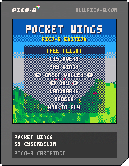

# Pocket Wings for PICO-8

An additional edition of Pocket Wings, alongside the
[PodBox Arcade version](../../pocketwings/). The supplied `pocketwings.p8`
is kept unchanged. It contains its Lua code, sprites, cartridge label and
sound effects in one file.



- [pocketwings.p8](pocketwings.p8): the editable source cartridge.
- [pocketwings.p8.png](pocketwings.p8.png): the same game as a PICO-8
  cartridge image, exported with PICO-8 0.2.7.

Both files are for PICO-8. The iPod version is still built from
`pocketwings/` as `pocketwings.pbg` using the PodBox SDK. The two editions
have separate controls and saved progress.

## Playing

Drag either cartridge into PICO-8, then run it with Ctrl+R. See the
[official PICO-8 manual](https://www.lexaloffle.com/dl/docs/pico-8_manual.html)
for loading cartridges and keyboard configuration.

| Control | Action |
| --- | --- |
| Left / Right | Bank and turn |
| Up / Down | Climb and dive |
| O button, normally Z | Slow, cruise or fast |
| X button, normally X | Behind, cockpit or map |
| Enter / P | Pause and options |

On the title screen, Up and Down choose a row. Left and Right change the
landscape or time of day. O or X starts the selected mode or opens a page.

## This edition

The cartridge provides six landscapes, thirty landmarks, three times of
day and three views. Its modes are Free Flight, Discovery and Sky Rings.
Sky Rings has eight rings per landscape, with a saved best time. The pause
menu has height following, inverted pitch, engine sound and detail options.
Badges, landmarks and ring times use this edition's own saved data.

The PodBox builder doesn't compile this directory. The Build workflow
uploads these PICO-8 files as their own artifact and includes them beside
the `.pbg` files in future tagged releases. Publishing still requires a
push or tag. The PICO-8 executable isn't stored in the repository or needed
by CI to distribute the cartridges.

The `.p8.png` file is a playable cartridge, not a normal screenshot. Keep
its bytes intact when copying or sharing it.

After editing the source, regenerate the image from this directory with
PICO-8 installed:

```sh
pico8 pocketwings.p8 -export pocketwings.p8.png
```
