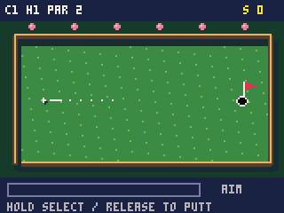

# Pocket Golf Deluxe

An original top-down miniature golf game for PodBox Arcade. It runs at
160x120 and keeps the owner's music playing. All 36 holes are authored.
No course layouts, sounds or artwork were copied from another game.

Sunny Gardens introduces banks, rough grass, sand, slopes and tunnels.
Pirate Cove adds islands, bridges, teleporters and a rotating platform.
Desert Adventure combines ramps, switches, gates and temple bumpers.
Winter Wonderland uses ice, frozen bridges and harder mixed obstacles.
Each theme has nine holes with par values from two to five.



Native previews for [Pirate Cove](previews/pirate.png),
[Desert Adventure](previews/desert.png) and
[Winter Wonderland](previews/winter.png) are included too. Regenerate
them with `python3 tools/pocketgolf_preview.py`.

Quick Play selects an unlocked hole. Championship plays nine holes.
Full Tour plays all 36 and opens the next course after each scorecard.
Practice doesn't change personal records. Records include low scores per
hole, course and tour, total holes played and holes in one. The Records
menu has career stats. Four native achievements reward progress.

## Controls

| Control | Action |
| --- | --- |
| Wheel | Aim while the ball is at rest |
| Hold Select | Build power, capped after 45 simulation ticks |
| Release Select | Putt once |
| Prev | Toggle precision, with four times finer aim |
| Next | Toggle the aiming guide |
| Play | Toggle course overview, including while the ball rolls |
| Menu | Native pause, settings and round actions |

A held Select across a menu or pause is consumed. Release it before
charging another shot. Changing an option cancels a charged putt.
The native menu can save and return to the title, restart the hole or
pick up for at least 12 strokes. Autoplay never picks up the ball.
Water returns the ball to the last dry position and adds one penalty.
Purple rings mark tunnel or teleport entry and exit points. Arrow marks
show slopes and ramps. Slow putts drop into the cup. Fast putts pass over.

## Build and release

Use the sibling SDK at `../podbox/arcade/sdk`. Follow its README to install
Node dependencies and build the native VM with `sh host/build.sh`.

```sh
node ../podbox/arcade/sdk/pbgc.js build pocketgolf -o dist/pocketgolf.pbg
```

The repository's `sh build.sh` also discovers this cart automatically.
Use the individual command above when another developer is changing the
other games. The test and export tools accept the `SDK` environment variable.

Art and plans are generated with Python and Pillow:

```sh
python3 -m pip install 'Pillow==12.3.0'
python3 tools/pocketgolf_assets.py
python3 tools/pocketgolf_assets.py --check
```

The generator owns all backgrounds, overview pictures, map files, hole
JSON, palette, logo and sprite sheet. Edit `HOLES` in that script rather
than hand-editing its output. `tools/pocketgolf_routes.json` contains
navigation hints for tests. Those hints aren't shipped in the cartridge.
Check mode compares image pixels and palettes rather than PNG compression
bytes, which can differ between operating systems.

Build the self-contained browser player:

```sh
node tools/pocketgolf_web.mjs
```

This requires the SDK's `esbuild` development dependency and internet
access for the pinned official WASM player. It writes a `.pbg`, `.html`,
runtime and release checksum manifest under `dist/`. It also accepts
`--sdk`, `--out`, `--runtime` and `--esbuild` paths. A supplied runtime's
checksum is recorded in the manifest. The downloaded runtime is checked
against a pinned checksum. SDK font and runtime notices are embedded in
the HTML. The HTML has no external runtime dependencies.

The independent `.github/workflows/pocketgolf.yml` checks generated assets,
builds the releases and runs native and browser tests. It pins SDK commit
`126ebba20eb4f650d98ec03e6838d226af2e7013`. It uploads a private workflow
artifact. It doesn't publish a release or deploy Pages.

## Verification

```sh
python3 tools/pocketgolf_test.py
python3 tools/pocketgolf_test.py --selftest
python3 tools/pocketgolf_test.py --browser-runtime dist/pocketgolf-runtime.wasm --keep dist/pocketgolf-checks
```

The scratch pilot evaluates trajectories using the production VM physics.
It then drives the real wheel, hold and release handlers. Its input trace
replays against an uninstrumented cartridge. The replay must complete all
36 holes with no pickups. The test fails on a budget violation.

The probe checks ball bounds, wall clearance, speed, geometry capacity,
shot power, loaded artwork and score state. It checks every replay tick
and every tick of seeded stress input on all 36 holes. Other checks cover
minimum and maximum power, angled and corner reflections, thin walls,
curved bumpers, friction, slopes, moving gates, ramps, water, tunnels,
teleports, boosts and slow cup capture. Fault injection removes collision
resolution to prove that the physics test reports failures.

Control checks cover held buttons, precision, all mode menus, cancelled
charging, pause and VM suspension. Fresh VM tests restore an in-flight
ball with the same velocity and obstacle phase. Completed rounds resume
without scoring again. Practice leaves ranked records intact. The 33 Hz
and 25 Hz schedules produce identical physical steps. Browser WASM must
match the native full-tour checkpoint and units exactly. A separate test
loads all holes ten times in one 512 KB VM to check lazy image lifetimes.

A measured full tour completes in 54 strokes over 41,593 replay ticks.
This is a solvability check by a search program. It doesn't measure human
difficulty or prove that every possible shot sequence is safe.

## Performance

The iPod Video with FLAC is the reference. The targets are 12,500 units
per tick at 33 Hz and 17,500 at 25 Hz. Ordinary play runs at 33 Hz. Four
short loading ticks use 25 Hz so large background decompression can fit.
More than four reported skips in a second selects 25 Hz for that hole.
The ball still uses fixed 33 Hz simulation steps with an integer debt.

Measured on the pinned native VM, without test code:

| Full-tour replay | Mean | 99th percentile | Maximum | Budget |
| --- | ---: | ---: | ---: | ---: |
| 33 Hz, 41,449 ticks | 2,713 | 3,465 | 11,973 | 12,500 |
| 25 Hz loading, 144 ticks | 2,884 | 14,640 | 17,414 | 17,500 |

The performance overlay is tested too. Seeded stress stays within both
budgets. Loading the largest background has little spare budget. Keep
extra work out of that loading step. Save ticks reuse the previous screen
and coalesce multiple event saves into one disk write.

For a quick native measurement and screenshot:

```sh
mkdir -p /tmp/pocketgolf-save
../podbox/arcade/sdk/host/pbgvm dist/pocketgolf.pbg --ticks 300 --seed 1 --units --buttons 2:16,3:0,20:16,55:0 --store /tmp/pocketgolf-save --shot /tmp/pocketgolf.png
```

Units go to stderr. Masks are Prev=1,
Next=2, Menu=4, Play=8 and Select=16. Input event tick zero is the first
frame. `--wheel 30:12:-1` supplies wheel clicks. The autoplay rollouts need
an explicitly raised scratch-build ceiling. Their cost isn't reported as
gameplay cost. Native VM units don't measure disk latency, screen transfer
or all garbage collection time. Hardware testing with FLAC is still needed.

## Architecture and editing rules

| File | Responsibility |
| --- | --- |
| `cart.json` | Stable cart ID, 33 Hz default, options, low-score boards and achievements |
| `main.js` | Modes, scene transitions, scoring, fixed-step schedule and staged loading |
| `putter.js` | Wheel precision, edge-safe toggles and hold/release power |
| `ball.js` | Fixed-point velocity, friction, slopes, height, hazards and cup capture |
| `geometry.js` | Reusable segment/circle arrays, broad-phase bounds and contact normals |
| `course.js` | One plan at a time, lazy images, surfaces and special fields |
| `records.js` | Versioned round save, coalesced writes and restoration |
| `view.js` | Cached opaque background, ball-follow camera and half-scale overview |
| `hud.js` | Shot display, scorecards, results and help |
| `data/hNN.json` | Authoritative collision and surface metadata for each hole |
| `maps/hNN.json` | Separate native map with surface tiles and tee/cup objects |
| `tools/pocketgolf_*` | Asset generation, search pilot, invariants, release checks and HTML export |

Static art is cached in lazy images. Only the current background and its
optional overview stay loaded. Collision uses metadata rather than sprite
pixels. Segments carry normalized tangents, height and restitution. Ball
movement is split into steps of at most 0.65 pixels at a maximum speed of
3.2 pixels per simulation tick. Contacts separate the ball before
reflecting incoming velocity. Endpoint normals provide round corners.
Moving gates can push resting balls. Ramps permit short airborne trips
over low barriers. Tunnels and teleporters preserve controlled momentum
and use a re-entry cooldown.

Rendering and camera functions don't write to the simulation. Avoid
`rspr`, per-pixel drawing and allocations in the rolling-ball loop.
Perform broad-phase checks before squared distances. Keep fixed-point
values within -32768 to 32767 and guard large coordinate differences.
Integer division truncates. Use a fractional divisor when needed.

The cart uses the SDK's small JS subset. Each extra root `.js` is a
namespace. Use `var` inside functions. Top level contains declarations.
Global names can't clash with API names. Plain arrays can't be written
past their end. Keep the existing explicit namespace calls, short comments
and event-driven saves. Art changes go through the generator. Game code,
docs and commit messages are English, with no em dashes or Oxford commas.

Round state is in `store` file `round`. Native `dget` slots are 0 for
unlocked courses, 1 for holes played, 2 for holes in one, 3 for best tour,
10-45 for best holes and 50-53 for best courses. Keep the cart ID stable.
A save preserves the ball, velocity, height, dry point, moving-obstacle
clock, gate state, scorecard and simulation debt. A partly charged shot
isn't saved. New rounds and Practice share one current-round slot.

## Remaining release checks

The software build, native autoplay, browser WASM parity and headless
stress checks are complete. Real iPod Classic and Video testing with FLAC
is still open. So are human click-wheel playtests, difficulty balancing
and interactive browser testing of audio, touch controls and storage.
The tests don't replace those checks. Use the local `.pbg` and HTML for
that review before calling this a hardware-validated release.

GitHub Releases and Pages publication are intentionally pending. Nothing
has been pushed. Shared project docs and other carts are maintained by
another developer and aren't part of this change.
